# LAPORAN PRAKTIKUM PEMROGRAMAN BERBASIS OBJEK

| Informasi Praktikan | Keterangan |
| :--- | :--- |
| **Nama** | Muhammad Salman Al Farisi |
| **NPM** | 4525210141 |
| **Kelas** | A |
| **Mata Kuliah** | Pemrograman Berbasis Objek (PBO) |
| **Pertemuan** | 11 - Collections, Generics, dan Operasi Fungsional (Unit Test Pertama) |
| **Tanggal** | 17 November 2026 |

---

## 1. Implementasi Java (Maven)

### 1.1. File: `pom.xml`
**Penjelasan Kode:**
> Ditambahkan dependensi JUnit 5 (`org.junit.jupiter:junit-jupiter:5.11.3`) dengan `scope` `test`, sehingga hanya tersedia saat pengujian dan tidak ikut masuk ke berkas `.jar` produksi. Ditambahkan juga `maven-surefire-plugin` 3.5.2, yang menjalankan kelas `*Test` di `src/test/java` saat `mvn test`.

**Bukti Eksekusi (Screenshot):**
* **Before** *(Kondisi awal / Kesalahan kompilasi)*:
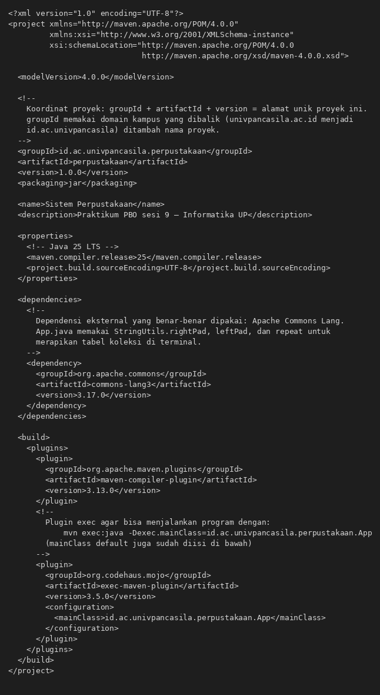

* **After** *(Kondisi akhir / Eksekusi berhasil)*:
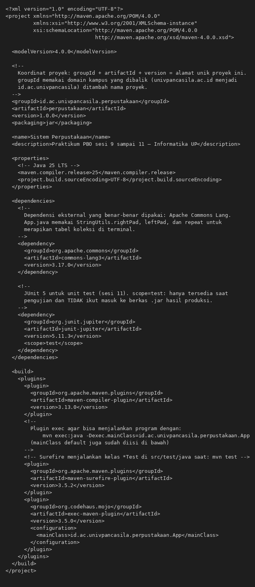

### 1.2. File: `Repository.java`
**Penjelasan Kode:**
> Kelas generik `Repository<T>`. `T` adalah type parameter yang baru ditentukan saat kelas dipakai (`Repository<Buku>`). Data disimpan di `LinkedHashMap<String, T>` sehingga pencarian lewat ID langsung tanpa perulangan, dan urutan simpan terjaga. Kunci item diambil lewat `Function<T, String>` yang diberikan ke constructor, sehingga `Repository` tidak perlu tahu apa pun tentang `T`. `simpan` menolak `null` dan menimpa item berkunci sama, `cariById` mengembalikan `Optional<T>` (tidak pernah `null`), `cariSemua` mengembalikan salinan tak-berubah (`List.copyOf`), dan `hapus` mengembalikan `true` bila ada yang terhapus. Gambar Before memperlihatkan kerangka awal: kelima uji awal gagal karena TODO belum dikerjakan.

**Bukti Eksekusi (Screenshot):**
* **Before** *(Kondisi awal / Kesalahan kompilasi)*:
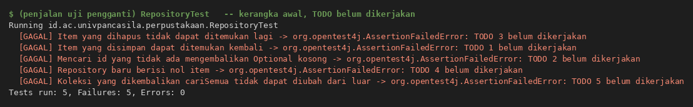

* **After** *(Kondisi akhir / Eksekusi berhasil)*:
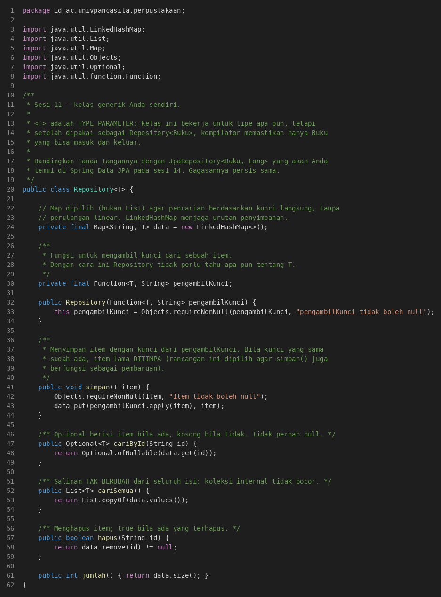

### 1.3. File: `service/LibraryService.java`
**Penjelasan Kode:**
> `LibraryService` hasil sesi 10 (guard clause dengan empat exception) yang struktur datanya diganti koleksi: `Repository<Buku>` untuk buku (dicari lewat nomor induk atau ISBN) dan `Map<String, Integer>` untuk jumlah pinjaman per anggota. Stok dan judul kini milik objek `Buku`, sehingga beberapa `Map` paralel tidak diperlukan lagi. Pencarian buku memakai `orElseThrow(() -> new BukuTidakDitemukanException(isbn))`, dan `cariBuku` mengembalikan `Optional<Buku>`. Urutan guard tetap: anggota, buku, stok, lalu batas pinjam. Alasan pilihan struktur ada di [pilihan-koleksi.md](pilihan-koleksi.md).

**Bukti Eksekusi (Screenshot):**
* **Before** *(Kondisi awal / Kesalahan kompilasi)*:
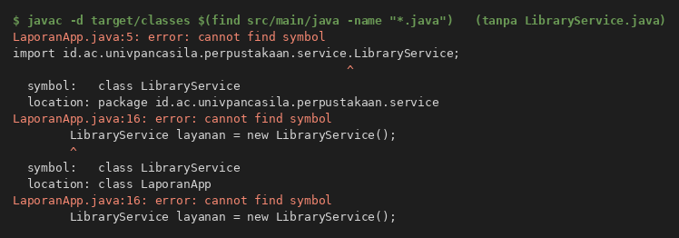

* **After** *(Kondisi akhir / Eksekusi berhasil)*:
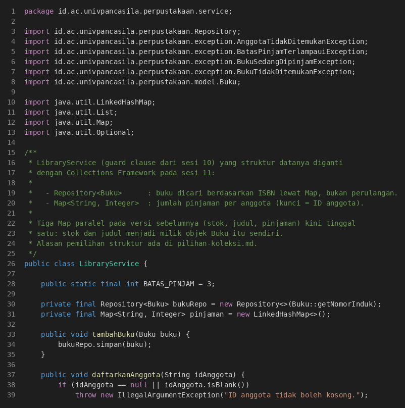
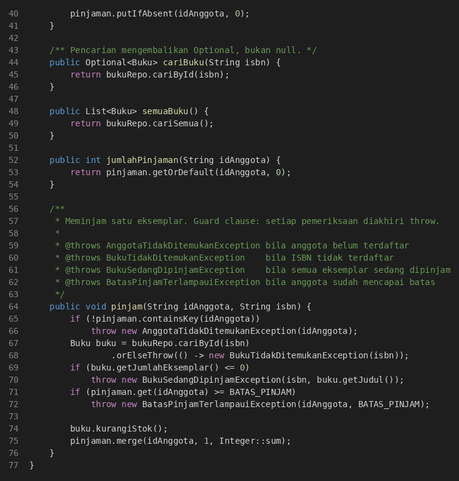

### 1.4. File: `service/LaporanBuku.java dan LaporanApp.java`
**Penjelasan Kode:**
> Tiga laporan memakai Stream, tanpa satu pun perulangan `for` di `LaporanBuku`: (1) **filter** `Buku::tersedia` untuk buku yang tersedia, (2) **map** `Buku::getJudul` lalu `Collectors.joining("; ")` untuk seluruh judul, dan (3) **groupingBy** `Buku::getPenulis` dengan `counting()` untuk jumlah buku per penulis (`LinkedHashMap` menjaga urutan kemunculan). `LaporanApp` menyiapkan lima buku dan mencetak ketiga laporan beserta contoh `Optional` (`map(...).orElse("(tidak ada)")`). Pada `PerpustakaanService`, `cariKoleksi` yang dulu mengembalikan `null` kini mengembalikan `Optional<Koleksi>`.

**Bukti Eksekusi (Screenshot):**
* **Before** *(Kondisi awal / Kesalahan kompilasi)*:
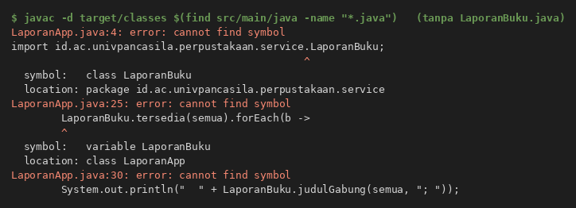

* **After** *(Kondisi akhir / Eksekusi berhasil)*:
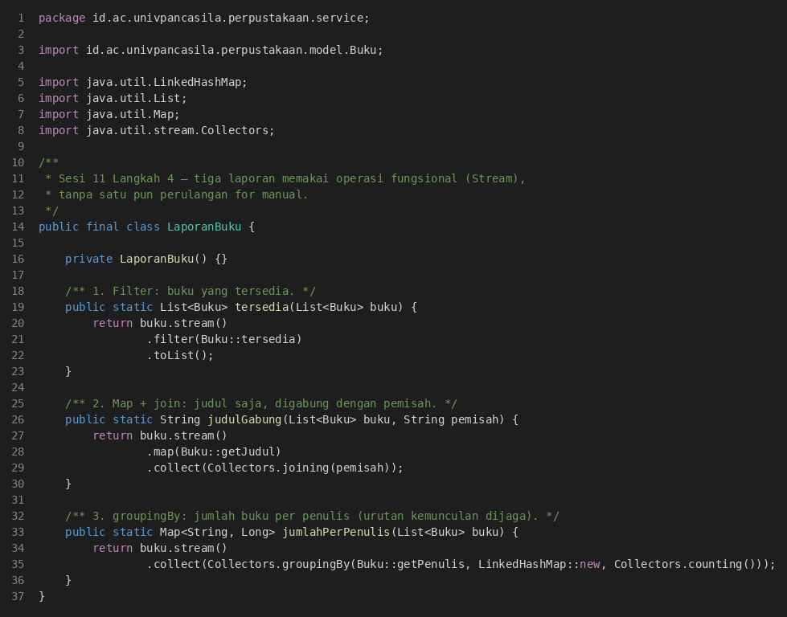
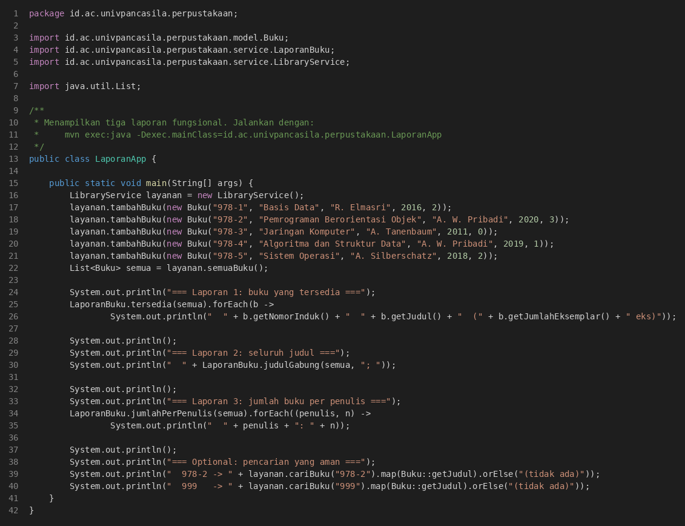

### 1.5. File: `RepositoryTest.java (src/test/java)`
**Penjelasan Kode:**
> Unit test pertama dengan JUnit 5. Lima uji dari kerangka dikerjakan (simpan lalu temukan, id tidak ada mengembalikan `Optional` kosong, hapus, repository baru berisi nol item, dan koleksi hasil `cariSemua` tidak bisa diubah dari luar), ditambah tiga uji lain: kunci sama menimpa, menghapus id yang tidak ada mengembalikan `false`, dan menyimpan `null` ditolak. `@BeforeEach` membuat `Repository` baru sebelum setiap uji, sehingga uji tidak saling memengaruhi, dan pola tiap uji adalah siapkan, jalankan, lalu periksa. Seluruhnya 8 uji.

**Bukti Eksekusi (Screenshot):**
* **Before** *(Kondisi awal / Kesalahan kompilasi)*:


* **After** *(Kondisi akhir / Eksekusi berhasil)*:
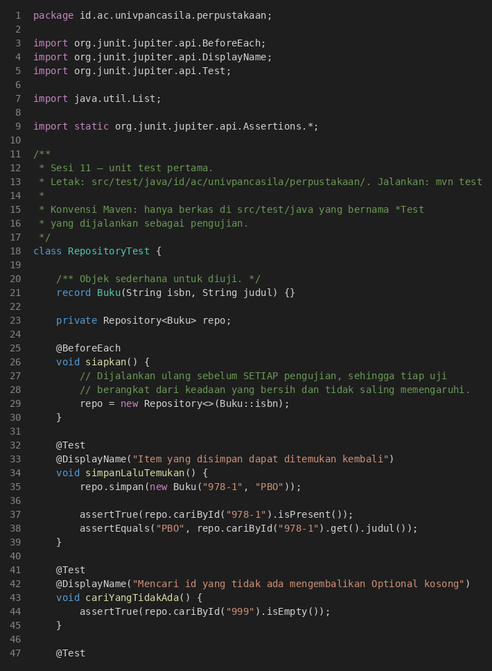
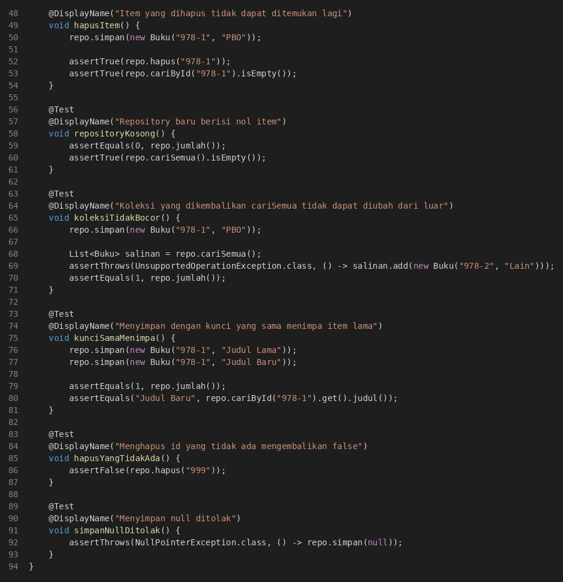

### 1.6. File: `service/LibraryServiceTest.java (src/test/java)`
**Penjelasan Kode:**
> Skenario kegagalan sesi 10 diubah menjadi uji otomatis dengan `assertThrows`: ISBN tidak terdaftar, anggota tidak terdaftar, ID dan ISBN sama-sama salah (anggota diperiksa lebih dahulu), stok habis, dan pinjaman ke-4. Selain jenis exception, data yang dibawa (`getIsbn()`, `getJudul()`, `getBatas()`) ikut diperiksa. Tiga uji tambahan memeriksa pinjam yang berhasil, pinjam yang gagal tidak mengubah stok, dan `cariBuku` yang kosong. Seluruhnya 8 uji. Pemetaan skenario ke uji ada di [catatan-uji.md](catatan-uji.md).

**Bukti Eksekusi (Screenshot):**
* **Before** *(Kondisi awal / Kesalahan kompilasi)*:


* **After** *(Kondisi akhir / Eksekusi berhasil)*:
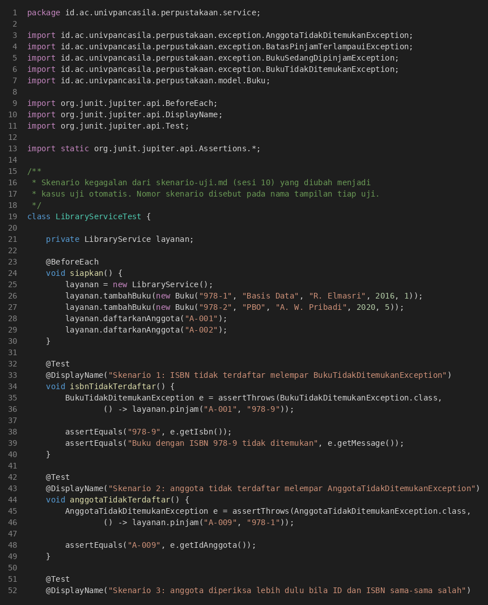
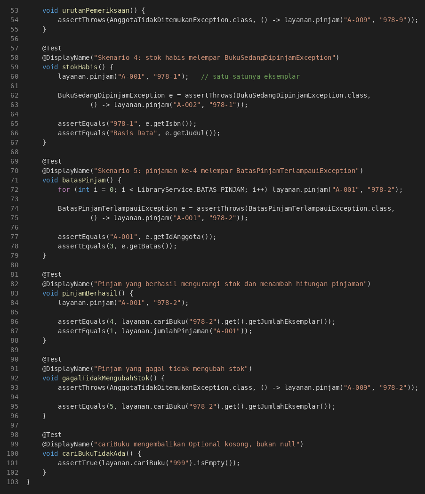

### Output
**Output Program:**

`mvn test`

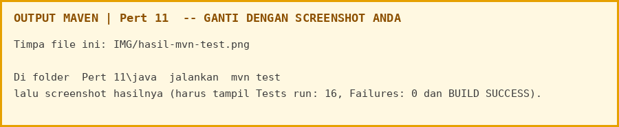

`mvn exec:java -Dexec.mainClass=id.ac.univpancasila.perpustakaan.LaporanApp`

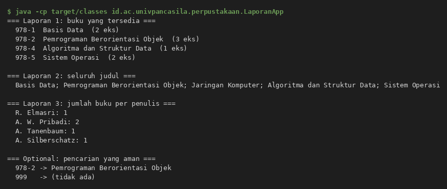

---

## 2. Implementasi PHP (Composer)

### 2.1. File: `composer.json`
**Penjelasan Kode:**
> Ditambahkan dependensi pengembangan `phpunit/phpunit` (`^11.5`) pada `require-dev`, sehingga PHPUnit hanya terpasang untuk pengembangan. Pemetaan PSR-4 `Perpustakaan\Tests\` ke `tests/` sudah disiapkan sejak sesi 9. Ditambahkan juga `phpunit.xml.dist` yang menunjuk `vendor/autoload.php` dan folder `tests`.

**Bukti Eksekusi (Screenshot):**
* **Before** *(Kondisi awal / Galat logika)*:
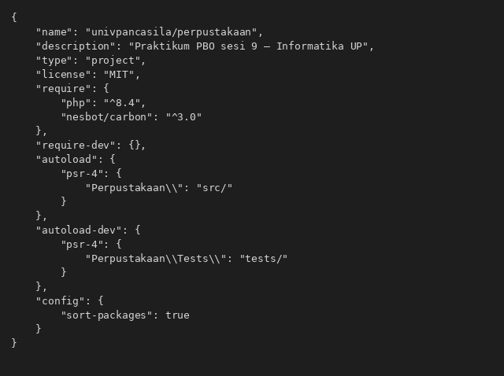

* **After** *(Kondisi akhir / Eksekusi berhasil)*:
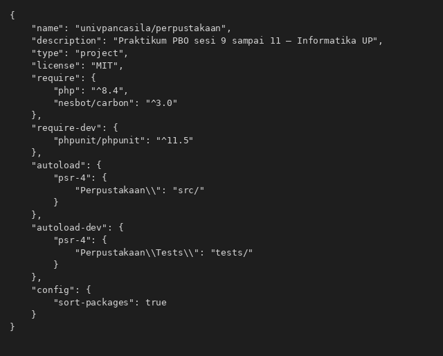

### 2.2. File: `src/Model/KoleksiBuku.php`
**Penjelasan Kode:**
> PHP tidak punya generics, sehingga dipakai padanan kedua: **typed collection**, yaitu kelas pembungkus yang memvalidasi isinya (`simpan(Buku $b)` menolak tipe lain dengan `TypeError`). Kelas ini `implements IteratorAggregate, Countable` sehingga bisa dipakai di `foreach` dan `count()`. Metode yang dikerjakan: `simpan` (kunci nomor induk, menimpa bila sama), `cariByIsbn` (`?Buku`), `filter` (`array_filter` lalu `array_values` agar indeks tidak berlubang), `map` (`array_map`, perhatikan urutan argumennya kebalikan dari `array_filter`), `jumlahkan` (`array_reduce`), dan `kelompokkan` (pengelompokan manual yang menjaga urutan kemunculan).

**Bukti Eksekusi (Screenshot):**
* **Before** *(Kondisi awal / Galat logika)*:
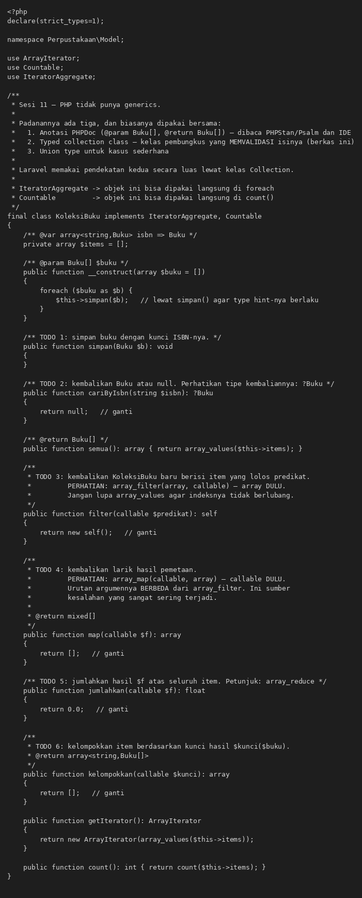

* **After** *(Kondisi akhir / Eksekusi berhasil)*:
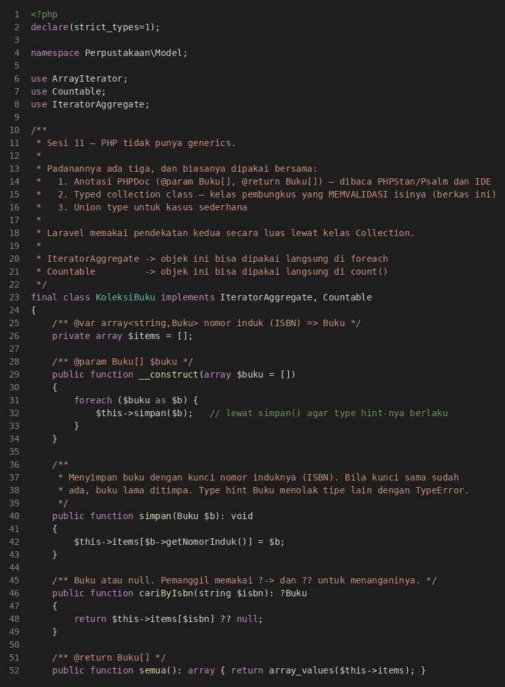
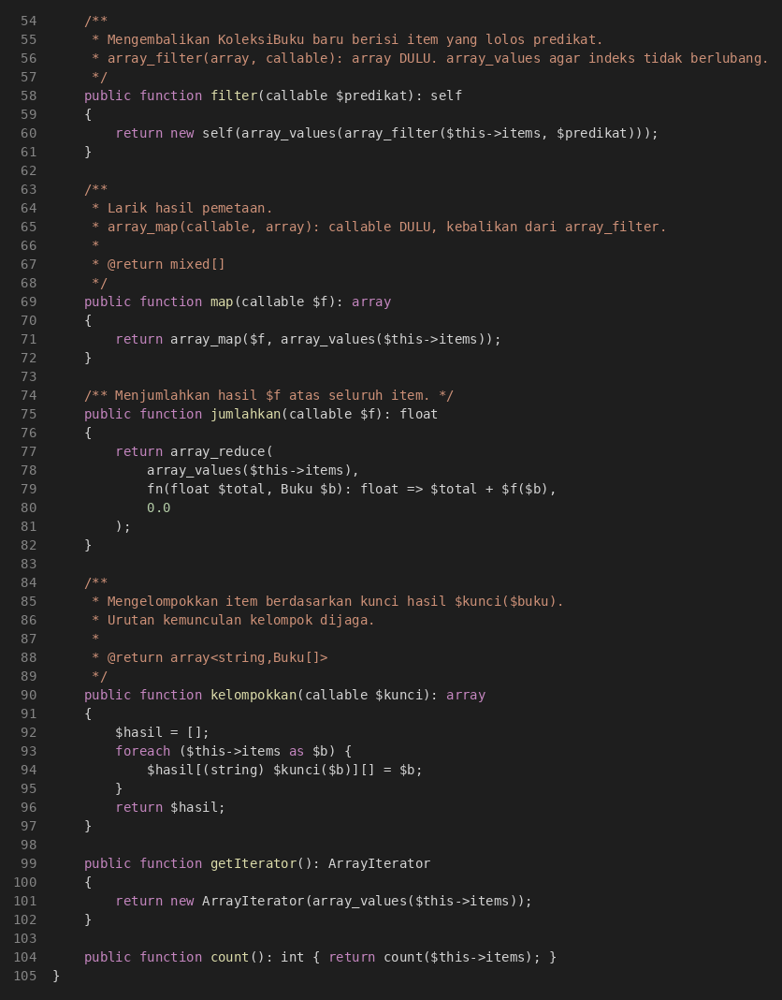

### 2.3. File: `src/Service/LibraryService.php dan LaporanBuku.php`
**Penjelasan Kode:**
> `LibraryService` PHP mengikuti versi Java: buku disimpan di `KoleksiBuku`, pinjaman per anggota di array asosiatif, dan `pinjam` berupa guard clause dengan `?? throw new BukuTidakDitemukanException($isbn)`. Pencarian memakai `?Buku` yang ditangani dengan `?->` dan `??`. `LaporanBuku` mengerjakan tiga laporan: `filter`, `map` dengan `implode`, dan `kelompokkan` dengan `array_map('count', ...)`. `laporan.php` adalah padanan `LaporanApp`.

**Bukti Eksekusi (Screenshot):**
* **Before** *(Kondisi awal / Galat logika)*:
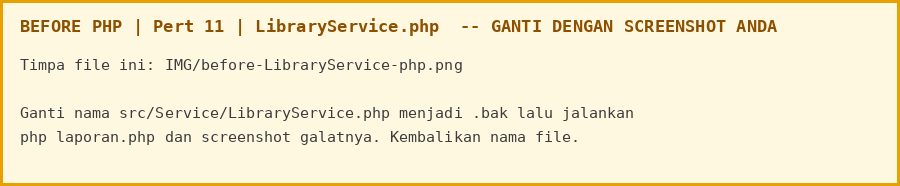

* **After** *(Kondisi akhir / Eksekusi berhasil)*:
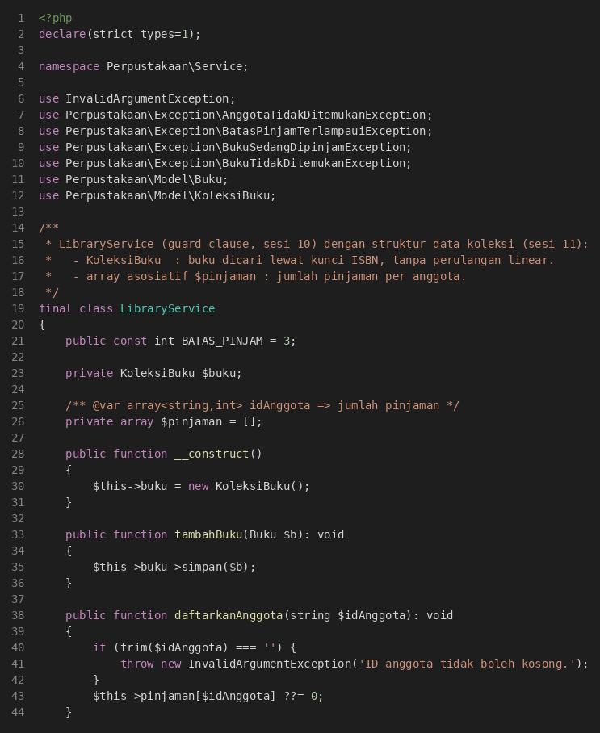
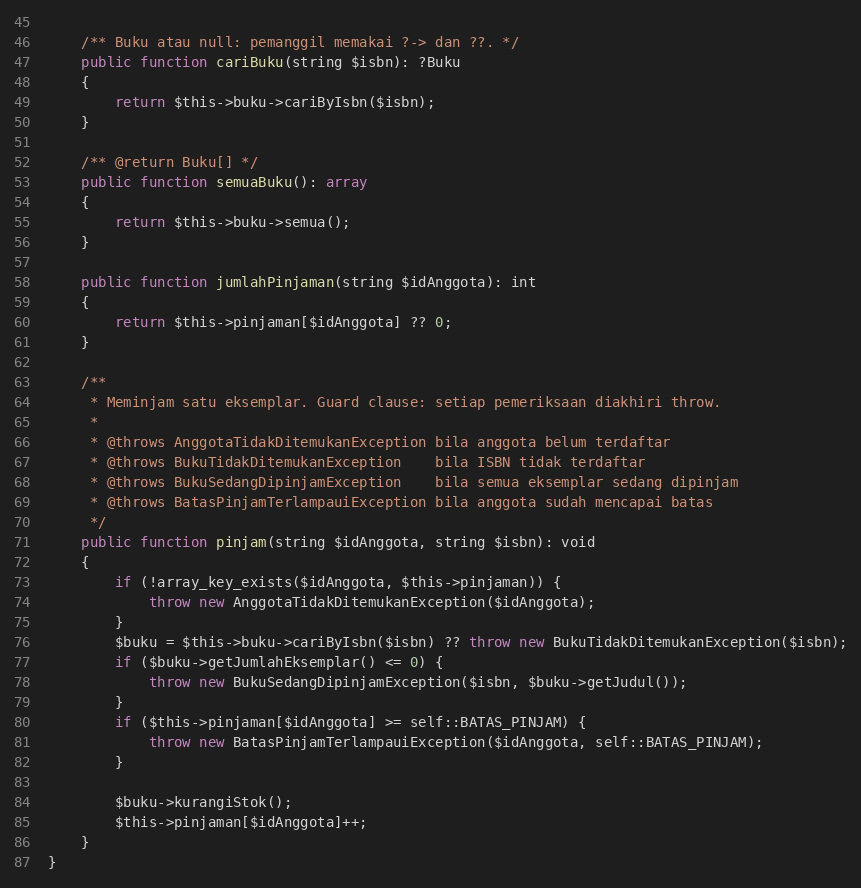
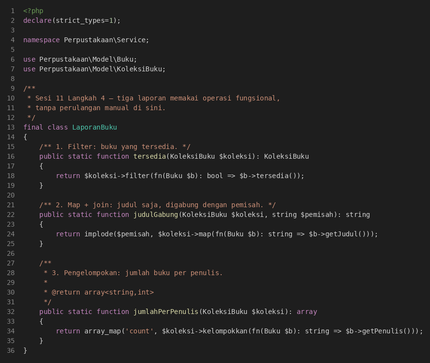

### 2.4. File: `src/Exception/ (dari sesi 10)`
**Penjelasan Kode:**
> Lima kelas exception domain (`PerpustakaanException` sebagai induk abstrak dan empat turunan yang membawa data: `BukuTidakDitemukanException`, `AnggotaTidakDitemukanException`, `BukuSedangDipinjamException`, `BatasPinjamTerlampauiException`) di namespace `Perpustakaan\Exception`. Kelas-kelas ini dipakai oleh `LibraryService` dan diuji dengan `expectException`.

**Bukti Eksekusi (Screenshot):**
* **Before** *(Kondisi awal / Galat logika)*:
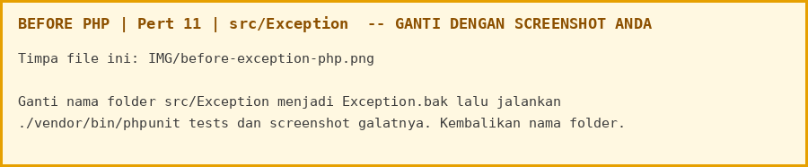

* **After** *(Kondisi akhir / Eksekusi berhasil)*:
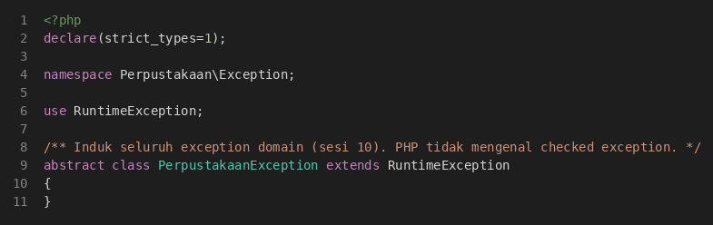
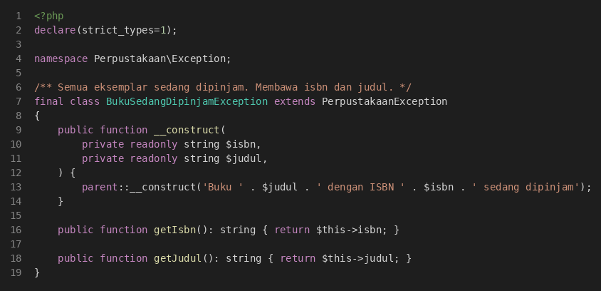

### 2.5. File: `tests/KoleksiBukuTest.php`
**Penjelasan Kode:**
> Uji PHPUnit untuk typed collection. Lima uji dari kerangka dikerjakan (simpan lalu temukan, ISBN yang tidak ada mengembalikan `null`, koleksi baru berisi nol item, filter, dan jumlahkan), ditambah empat uji lain: kunci sama menimpa, `map` mengembalikan larik berurutan, `kelompokkan` per penulis, dan `filter` tidak mengubah koleksi asal. `setUp()` membuat koleksi baru sebelum setiap uji. Seluruhnya 9 uji.

**Bukti Eksekusi (Screenshot):**
* **Before** *(Kondisi awal / Galat logika)*:
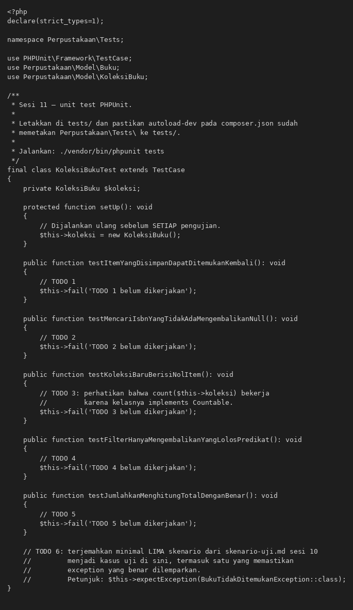

* **After** *(Kondisi akhir / Eksekusi berhasil)*:
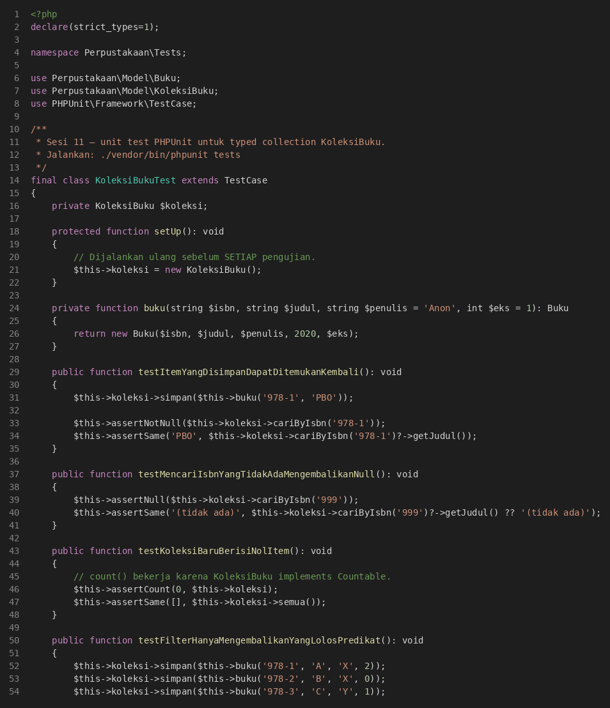
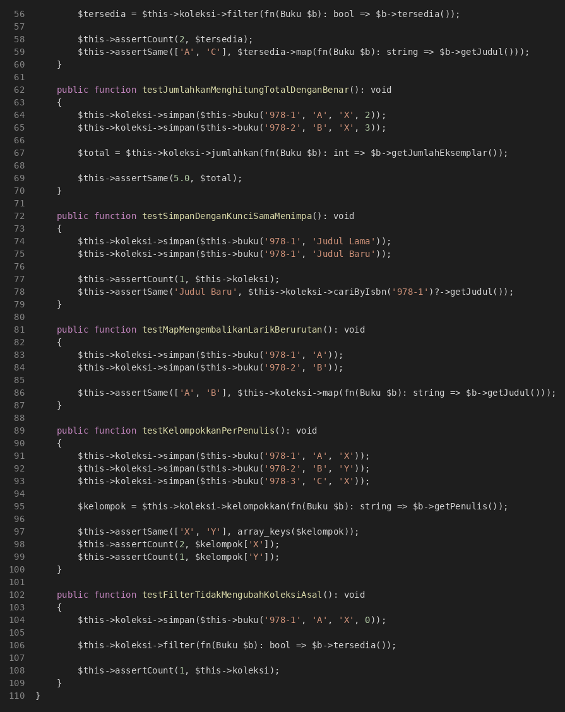

### 2.6. File: `tests/LibraryServiceTest.php`
**Penjelasan Kode:**
> Padanan PHP dari `LibraryServiceTest`: lima skenario kegagalan sesi 10 (memakai `expectException` atau `try`/`catch` untuk memeriksa data exception) dan tiga uji tambahan. Seluruhnya 8 uji.

**Bukti Eksekusi (Screenshot):**
* **Before** *(Kondisi awal / Galat logika)*:


* **After** *(Kondisi akhir / Eksekusi berhasil)*:
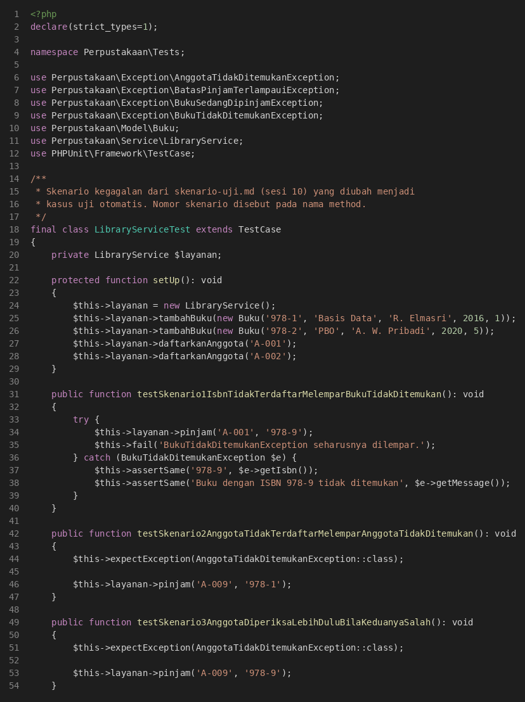
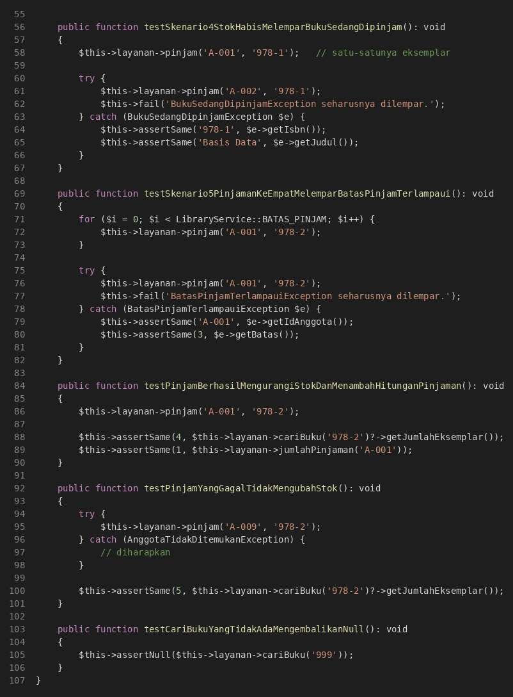

### Output
**Output Program:**

`./vendor/bin/phpunit tests`

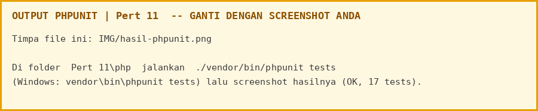

`php laporan.php`

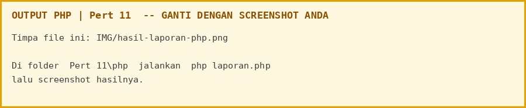

**Keluaran yang diharapkan** (identik dengan versi Java):
```text
=== Laporan 1: buku yang tersedia ===
  978-1  Basis Data  (2 eks)
  978-2  Pemrograman Berorientasi Objek  (3 eks)
  978-4  Algoritma dan Struktur Data  (1 eks)
  978-5  Sistem Operasi  (2 eks)

=== Laporan 2: seluruh judul ===
  Basis Data; Pemrograman Berorientasi Objek; Jaringan Komputer; Algoritma dan Struktur Data; Sistem Operasi

=== Laporan 3: jumlah buku per penulis ===
  R. Elmasri: 1
  A. W. Pribadi: 2
  A. Tanenbaum: 1
  A. Silberschatz: 1

=== Optional: pencarian yang aman ===
  978-2 -> Pemrograman Berorientasi Objek
  999   -> (tidak ada)
```

---

## 3. Kesimpulan

> Collections memberi wadah yang tepat untuk tiap kebutuhan: `Map` untuk pencarian lewat kunci (buku per ISBN), `List` untuk hasil berurutan, dan `Set` untuk data tanpa duplikat. Generics membuat kesalahan tipe ditolak saat kompilasi (Java), sedangkan PHP hanya bisa menolaknya saat jalan sehingga dipakai typed collection. `Optional` dan nullable (`?->`, `??`) memaksa kasus kosong ditangani. Operasi fungsional (filter, map, groupingBy) menggantikan perulangan manual, dan unit test mengubah skenario kegagalan sesi 10 menjadi pemeriksaan otomatis yang langsung menunjuk bagian yang rusak.
>
> | Hal | Java | PHP |
> |---|---|---|
> | Koleksi buku | `Repository<Buku>` (`LinkedHashMap`) | `KoleksiBuku` (array asosiatif) |
> | Pengaman tipe | generics, ditolak saat kompilasi | type hint `Buku`, `TypeError` saat jalan |
> | Kasus kosong | `Optional<T>` | `?Buku` dengan `?->` dan `??` |
> | Saring | `stream().filter(...)` | `array_filter($a, $fn)` lalu `array_values` |
> | Ubah bentuk | `stream().map(...)` | `array_map($fn, $a)` |
> | Kelompokkan | `Collectors.groupingBy(...)` | manual (`kelompokkan`) |
> | Kerangka uji | JUnit 5 (`mvn test`) | PHPUnit (`./vendor/bin/phpunit`) |
> | Persiapan tiap uji | `@BeforeEach` | `setUp()` |
> | Jumlah uji | 16 | 17 |
>
> Dokumen pendukung: [pilihan-koleksi.md](pilihan-koleksi.md) (pilihan struktur data, bukti generics, uji yang gagal dengan sengaja, dan latihan mandiri), [catatan-uji.md](catatan-uji.md), [persiapan-demo.md](persiapan-demo.md), dan folder [starter/](starter/) (berkas asli modul, tidak diubah).
>
> **Cara menjalankan** (prasyarat: JDK 25, Maven 3.9+, PHP 8.4+, Composer 2.x).
>
> Proyek Java:
> ```cmd
> cd "Pert 11\java"
> mvn test
> mvn exec:java -Dexec.mainClass=id.ac.univpancasila.perpustakaan.LaporanApp
> ```
>
> Proyek PHP:
> ```cmd
> cd "Pert 11\php"
> composer install
> vendor\bin\phpunit tests
> php laporan.php
> ```
