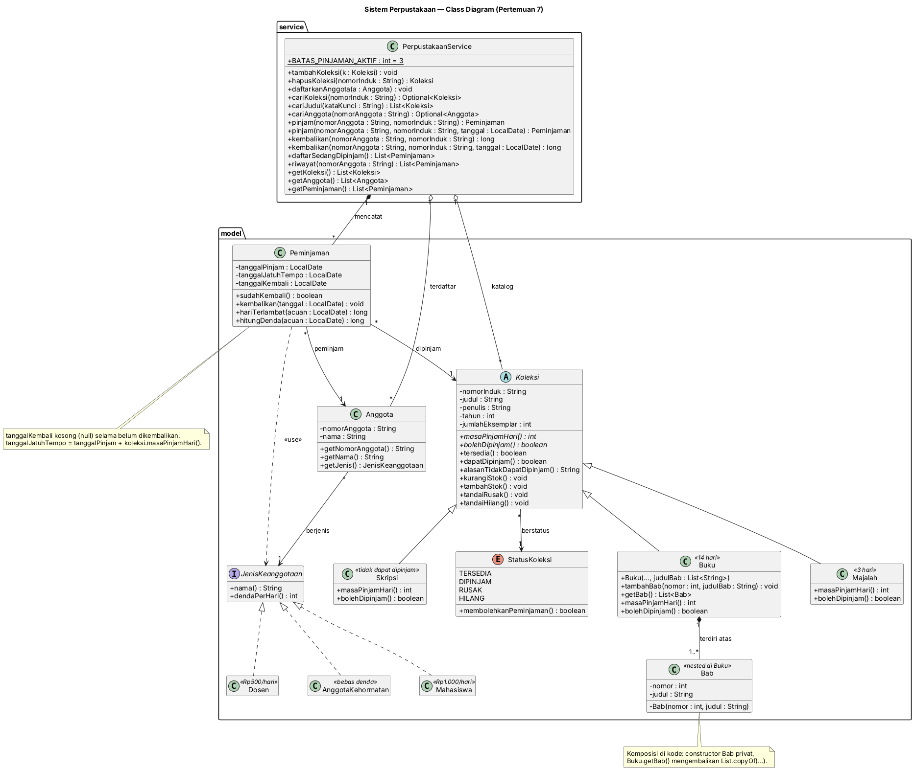
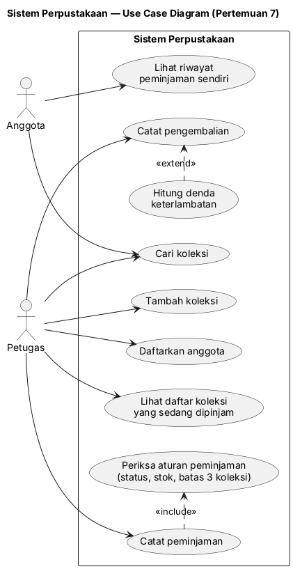
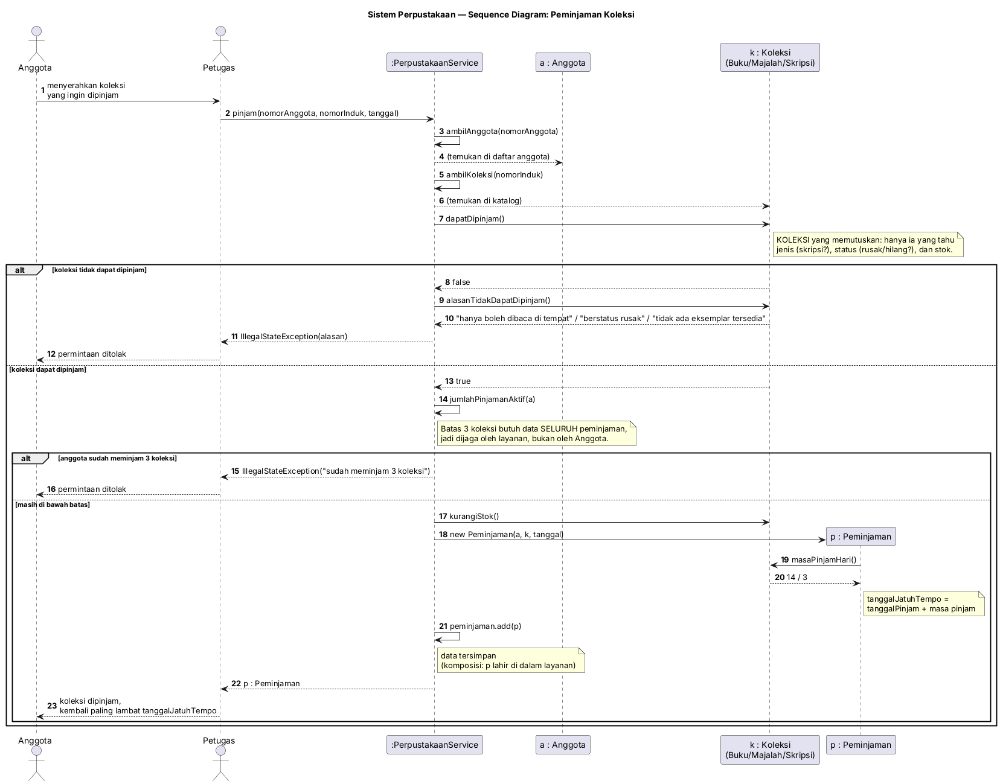
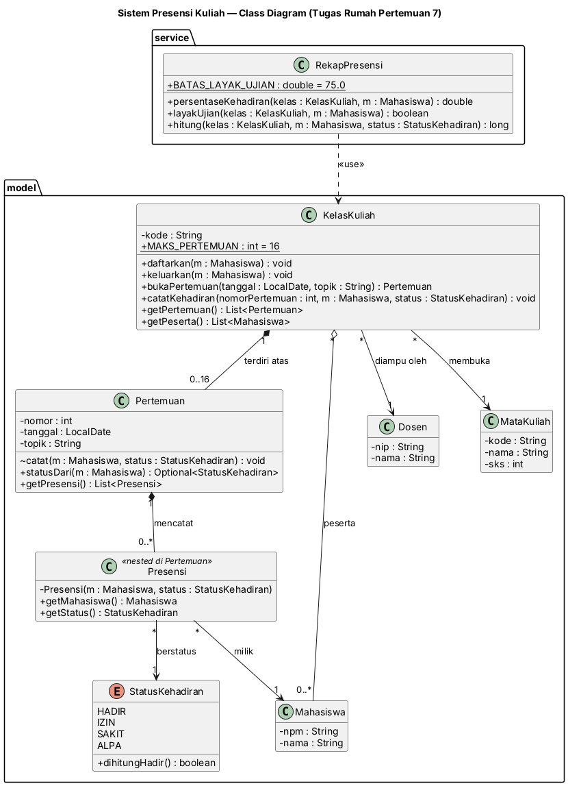

# LAPORAN PRAKTIKUM PEMROGRAMAN BERBASIS OBJEK

| Informasi Praktikan | Keterangan |
| :--- | :--- |
| **Nama** | Muhammad Salman Al Farisi |
| **NPM** | 4525210141 |
| **Kelas** | A |
| **Mata Kuliah** | Pemrograman Berbasis Objek (PBO) |
| **Pertemuan** | 7 - Pemodelan Relasi Objek dan UML Class Diagram |
| **Tanggal** | 20 Oktober 2026 |

---

## 0. Ringkasan Pekerjaan

Sistem Perpustakaan dimodelkan dari [deskripsi kebutuhan](starter/deskripsi-kebutuhan.md) menjadi analisis, tiga diagram UML, lalu diterjemahkan menjadi kode Java dan PHP yang strukturnya sama persis dengan diagram.

| Langkah modul | Hasil | Berkas |
|---|---|---|
| 1. Analisis kebutuhan | Kata benda, kata kerja, 12 aturan bisnis, alasan pencoretan | [analisis.md](analisis.md) |
| 2. Use case diagram | 2 aktor, 9 use case, 1 `include`, 1 `extend` | [uml/usecase.puml](uml/usecase.puml) |
| 3. Class diagram | Komposisi, agregasi, asosiasi, dependensi, dengan multiplicity | [uml/class.puml](uml/class.puml) |
| 4. Sequence diagram | 4 objek, 2 alur alternatif | [uml/sequence-pinjam.puml](uml/sequence-pinjam.puml) |
| 5. Diagram menjadi kode | Java dan PHP | [java/](java/), [php/](php/) |
| 6. Bukti relasi | Komposisi menolak diubah, agregasi tetap hidup | [bukti-relasi.md](bukti-relasi.md) |
| E. Latihan mandiri | Agregasi menjadi komposisi, activity diagram | [percobaan-mandiri.md](percobaan-mandiri.md) |
| F. Tugas rumah | Sistem Presensi Kuliah (Java dan PHP) | [tugas-rumah/](tugas-rumah/) |

### Class diagram



| Relasi | Jenis | Multiplicity |
|---|---|---|
| `Buku` — `Bab` | Komposisi | 1 ke `1..*` |
| `PerpustakaanService` — `Peminjaman` | Komposisi | 1 ke `*` |
| `PerpustakaanService` — `Koleksi`, `Anggota` | Agregasi | 1 ke `*` |
| `Peminjaman` — `Anggota`, `Koleksi` | Asosiasi | `*` ke 1 |
| `Anggota` — `JenisKeanggotaan`, `Koleksi` — `StatusKoleksi` | Asosiasi | `*` ke 1 |
| `Peminjaman` ⇢ `JenisKeanggotaan` | Dependensi | tanpa |

Alasan setiap relasi ada di [analisis.md](analisis.md), bagian 6.

### Use case dan sequence diagram





---

## 1. Implementasi Java

### 1.1. File: `model/StatusKoleksi.java`
**Penjelasan Kode:**
> Enum `TERSEDIA`, `DIPINJAM`, `RUSAK`, `HILANG` dengan `membolehkanPeminjaman()` yang hanya `false` untuk `RUSAK` dan `HILANG`. Aturan "rusak atau hilang tidak dapat dipinjam apa pun jenisnya" tinggal satu pernyataan di enum, bukan `if` yang tersebar.

### 1.2. File: `model/Koleksi.java`
**Penjelasan Kode:**
> Abstract class induk semua koleksi: `nomorInduk`, `judul`, `penulis`, `tahun`, `jumlahEksemplar`, dan `status`. `masaPinjamHari()` dan `bolehDipinjam()` dibiarkan abstrak karena tiap jenis punya aturan sendiri. `dapatDipinjam()` menggabungkan jenis, status, dan stok, sehingga **koleksi sendiri yang memutuskan** dapat-tidaknya ia dipinjam. Constructor menolak data kosong, tahun <= 0, dan eksemplar negatif; `kurangiStok()` menolak stok yang sudah nol.

### 1.3. File: `model/Buku.java`
**Penjelasan Kode:**
> **Komposisi** `Buku` memiliki `1..*` `Bab`. `Bab` adalah kelas bersarang dengan constructor privat, `tambahBab(nomor, judul)` menerima nomor dan judul (bukan objek `Bab`), `getBab()` mengembalikan `List.copyOf(...)`, dan constructor menolak daftar judul bab kosong. Masa pinjam 14 hari.

### 1.4. File: `model/Majalah.java dan model/Skripsi.java`
**Penjelasan Kode:**
> `Majalah` dipinjam 3 hari. `Skripsi` menjawab `bolehDipinjam() = false`, sehingga `PerpustakaanService` tidak butuh `instanceof` untuk mengecualikannya.

### 1.5. File: `model/JenisKeanggotaan.java, Mahasiswa.java, Dosen.java, AnggotaKehormatan.java`
**Penjelasan Kode:**
> Interface dengan `nama()` dan `dendaPerHari()`, dan tiga implementasi (Rp1.000, Rp500, Rp0). Dipilih interface, bukan enum, karena deskripsi menyebut akan ada jenis keanggotaan baru: jenis baru cukup menambah kelas (dibuktikan oleh `Alumni` di `Main`).

### 1.6. File: `model/Anggota.java`
**Penjelasan Kode:**
> `nomorAnggota` `final` tanpa setter (nomor tidak pernah berubah), nama dan jenis keanggotaan wajib diisi.

### 1.7. File: `model/Peminjaman.java`
**Penjelasan Kode:**
> Mencatat satu anggota, satu koleksi, tanggal pinjam, tanggal jatuh tempo (= tanggal pinjam + `koleksi.masaPinjamHari()`), dan tanggal kembali yang `null` selama belum dikembalikan (dibuka sebagai `Optional`). `hitungDenda()` = hari terlambat x `anggota.getJenis().dendaPerHari()`, hari terlambat tidak pernah negatif.

### 1.8. File: `service/PerpustakaanService.java`
**Penjelasan Kode:**
> **Agregasi** untuk `Koleksi` dan `Anggota` (diterima dari luar lewat `tambahKoleksi` dan `daftarkanAnggota`; `hapusKoleksi` mengembalikan objeknya) dan **komposisi** untuk `Peminjaman` (lahir di dalam `pinjam()`, getter salinan tak-berubah). `pinjam()` menegakkan aturan: koleksi harus `dapatDipinjam()` dan anggota maksimum tiga pinjaman aktif. `kembalikan()` mengembalikan denda dalam rupiah.

### 1.9. File: `Main.java`
**Penjelasan Kode:**
> Mendemokan komposisi (`getBab().clear()` ditolak, buku tanpa bab ditolak), agregasi (skripsi dilepas lalu dimasukkan lagi), seluruh aturan peminjaman, perhitungan denda tiga jenis keanggotaan, dan jenis keanggotaan baru `Alumni` tanpa menyunting kelas lama.

### Output
**Output Program:**

`java -cp out Main`

```text
=== Komposisi: Buku memiliki Bab ===
  PBO-001  Pemrograman Berorientasi Objek         A. W. Pribadi  2024 [3 eks, Tersedia] {3 bab}
    Bab 1: Paradigma Objek
    Bab 2: Enkapsulasi
    Bab 3: Pewarisan dan Polimorfisme

  Mencoba mengubah koleksi internal dari luar...
    Ditolak - koleksi bab tidak bisa diubah dari luar. Benar.

  Multiplicity 1..*: buku tanpa bab ditolak constructor
    Ditolak: Buku harus memiliki minimal satu bab

=== Agregasi: PerpustakaanService menaungi Koleksi dan Anggota ===
  PBO-001  Pemrograman Berorientasi Objek         A. W. Pribadi  2024 [3 eks, Tersedia] {3 bab}
  MJ-014   Majalah Informatika Edisi September    Redaksi        2026 [2 eks, Tersedia]
  SK-203   Sistem Informasi Perpustakaan          Dewi Kartika   2025 [1 eks, Tersedia]
  PBO-002  Algoritma Dasar                        B. Santoso     2020 [1 eks, Rusak] {1 bab}

  Mengeluarkan skripsi dari katalog...
    Katalog sekarang berisi 3 koleksi
    Objeknya tetap hidup di luar layanan: Sistem Informasi Perpustakaan
    Dimasukkan kembali, katalog berisi 4 koleksi

=== Peminjaman dan aturan bisnis ===
  Ani Lestari meminjam 'Pemrograman Berorientasi Objek' | pinjam 2026-10-01, tempo 2026-10-15, kembali -
  Sisa eksemplar PBO-001: 2
  Ditolak (Skripsi tidak boleh dipinjam): 'Sistem Informasi Perpustakaan' tidak dapat dipinjam: hanya boleh dibaca di tempat
  Ditolak (Koleksi rusak tidak boleh dipinjam): 'Algoritma Dasar' tidak dapat dipinjam: berstatus rusak
  Ditolak (Majalah habis (2 eksemplar sudah dipinjam)): 'Majalah Informatika Edisi September' tidak dapat dipinjam: tidak ada eksemplar tersedia
  Ditolak (Pinjaman keempat Ani melewati batas tiga): Ani Lestari sudah meminjam 3 koleksi

  Sedang dipinjam:
    Ani Lestari meminjam 'Pemrograman Berorientasi Objek' | pinjam 2026-10-01, tempo 2026-10-15, kembali -
    Ani Lestari meminjam 'Majalah Informatika Edisi September' | pinjam 2026-10-01, tempo 2026-10-04, kembali -
    Budi Santoso meminjam 'Majalah Informatika Edisi September' | pinjam 2026-10-01, tempo 2026-10-04, kembali -
    Ani Lestari meminjam 'Pemrograman Berorientasi Objek' | pinjam 2026-10-02, tempo 2026-10-16, kembali -

=== Pengembalian dan denda ===
  Ani (Mahasiswa, Rp1.000/hari), 5 hari terlambat -> Rp5.000
  Budi (Dosen, Rp500/hari), 10 hari terlambat -> Rp5.000
  Cici (Kehormatan, bebas denda), 10 hari terlambat -> Rp0
  Ditolak (Mengembalikan koleksi yang tidak dipinjam): Budi Santoso tidak sedang meminjam 'Pemrograman Berorientasi Objek'

  Riwayat Ani:
    Ani Lestari meminjam 'Pemrograman Berorientasi Objek' | pinjam 2026-10-01, tempo 2026-10-15, kembali 2026-10-20
    Ani Lestari meminjam 'Majalah Informatika Edisi September' | pinjam 2026-10-01, tempo 2026-10-04, kembali -
    Ani Lestari meminjam 'Pemrograman Berorientasi Objek' | pinjam 2026-10-02, tempo 2026-10-16, kembali -

=== Jenis keanggotaan baru tanpa menyunting kelas lama ===
  Dedi (Alumni, Rp750/hari), 10 hari terlambat -> Rp7.500
  Tidak ada satu pun kelas lama yang disunting.
```

---

## 2. Implementasi PHP

### 2.1. File: `src/Model/*.php`
**Penjelasan Kode:**
> Padanan PHP dari seluruh kelas model dalam satu berkas per kelas (namespace `Perpustakaan\Model`): `Koleksi` abstrak, `Buku`, `Majalah`, `Skripsi`, `Bab`, backed enum `StatusKoleksi`, interface `JenisKeanggotaan` beserta tiga implementasinya, `Anggota`, dan `Peminjaman`. `Bab` dibuat `final` dengan properti `readonly`, karena PHP mengembalikan larik by-value tetapi objek di dalamnya tetap berbagi referensi.

### 2.2. File: `src/Service/PerpustakaanService.php`
**Penjelasan Kode:**
> Padanan `PerpustakaanService` dengan aturan yang sama. `cariKoleksi()` mengembalikan `?Koleksi`, dan exception memakai `LogicException` dan `InvalidArgumentException`.

### 2.3. File: `main.php`
**Penjelasan Kode:**
> Padanan `Main.java` dengan autoloader sederhana (`spl_autoload_register`). Keluarannya sama dengan versi Java kecuali bagian "mengubah koleksi internal dari luar" yang memang berbeda sifat bahasanya (lihat `bukti-relasi.md`).

### Output
**Output Program:**

`php main.php`

```text
=== Komposisi: Buku memiliki Bab ===
  PBO-001  Pemrograman Berorientasi Objek         A. W. Pribadi  2024 [3 eks, Tersedia] {3 bab}
    Bab 1: Paradigma Objek
    Bab 2: Enkapsulasi
    Bab 3: Pewarisan dan Polimorfisme

  Mencoba mengubah koleksi internal dari luar...
    Larik pemanggil dikosongkan, bab di dalam buku masih: 3
    Mengubah isi Bab ditolak: Cannot modify readonly property Perpustakaan\Model\Bab::$judul

  Multiplicity 1..*: buku tanpa bab ditolak constructor
    Ditolak: Buku harus memiliki minimal satu bab

=== Agregasi: PerpustakaanService menaungi Koleksi dan Anggota ===
  PBO-001  Pemrograman Berorientasi Objek         A. W. Pribadi  2024 [3 eks, Tersedia] {3 bab}
  MJ-014   Majalah Informatika Edisi September    Redaksi        2026 [2 eks, Tersedia]
  SK-203   Sistem Informasi Perpustakaan          Dewi Kartika   2025 [1 eks, Tersedia]
  PBO-002  Algoritma Dasar                        B. Santoso     2020 [1 eks, Rusak] {1 bab}

  Mengeluarkan skripsi dari katalog...
    Katalog sekarang berisi 3 koleksi
    Objeknya tetap hidup di luar layanan: Sistem Informasi Perpustakaan
    Dimasukkan kembali, katalog berisi 4 koleksi

=== Peminjaman dan aturan bisnis ===
  Ani Lestari meminjam 'Pemrograman Berorientasi Objek' | pinjam 2026-10-01, tempo 2026-10-15, kembali -
  Sisa eksemplar PBO-001: 2
  Ditolak (Skripsi tidak boleh dipinjam): 'Sistem Informasi Perpustakaan' tidak dapat dipinjam: hanya boleh dibaca di tempat
  Ditolak (Koleksi rusak tidak boleh dipinjam): 'Algoritma Dasar' tidak dapat dipinjam: berstatus rusak
  Ditolak (Majalah habis (2 eksemplar sudah dipinjam)): 'Majalah Informatika Edisi September' tidak dapat dipinjam: tidak ada eksemplar tersedia
  Ditolak (Pinjaman keempat Ani melewati batas tiga): Ani Lestari sudah meminjam 3 koleksi

  Sedang dipinjam:
    Ani Lestari meminjam 'Pemrograman Berorientasi Objek' | pinjam 2026-10-01, tempo 2026-10-15, kembali -
    Ani Lestari meminjam 'Majalah Informatika Edisi September' | pinjam 2026-10-01, tempo 2026-10-04, kembali -
    Budi Santoso meminjam 'Majalah Informatika Edisi September' | pinjam 2026-10-01, tempo 2026-10-04, kembali -
    Ani Lestari meminjam 'Pemrograman Berorientasi Objek' | pinjam 2026-10-02, tempo 2026-10-16, kembali -

=== Pengembalian dan denda ===
  Ani (Mahasiswa, Rp1.000/hari), 5 hari terlambat -> Rp5.000
  Budi (Dosen, Rp500/hari), 10 hari terlambat -> Rp5.000
  Cici (Kehormatan, bebas denda), 10 hari terlambat -> Rp0
  Ditolak (Mengembalikan koleksi yang tidak dipinjam): Budi Santoso tidak sedang meminjam 'Pemrograman Berorientasi Objek'

  Riwayat Ani:
    Ani Lestari meminjam 'Pemrograman Berorientasi Objek' | pinjam 2026-10-01, tempo 2026-10-15, kembali 2026-10-20
    Ani Lestari meminjam 'Majalah Informatika Edisi September' | pinjam 2026-10-01, tempo 2026-10-04, kembali -
    Ani Lestari meminjam 'Pemrograman Berorientasi Objek' | pinjam 2026-10-02, tempo 2026-10-16, kembali -

=== Jenis keanggotaan baru tanpa menyunting kelas lama ===
  Dedi (Alumni, Rp750/hari), 10 hari terlambat -> Rp7.500
  Tidak ada satu pun kelas lama yang disunting.
```

Perbandingan dengan `diff` terhadap keluaran Java: hanya bagian "mengubah koleksi internal dari luar" yang berbeda, karena Java menolak `clear()` pada daftar tak-berubah, sedangkan PHP mengembalikan salinan larik dan menolak perubahan pada properti `readonly`.

---

## 3. Percobaan, Bukti, dan Tugas Rumah

| Berkas / folder | Isi |
|---|---|
| [bukti-relasi.md](bukti-relasi.md) | Percobaan: getter bocor (sebelum dan sesudah), `Bab` dari luar ditolak kompilator, multiplicity `1..*`, agregasi tetap hidup, catatan kelemahan PHP |
| [percobaan/](percobaan/) | `01-getter-bocor`, `02-agregasi-jadi-komposisi`, `03-bab-dari-luar`, `04-php-bab-dari-luar` |
| [percobaan-mandiri.md](percobaan-mandiri.md) | E1 agregasi menjadi komposisi (9 baris ditambah, 12 dihapus pada satu berkas), E2 activity diagram pengembalian dengan cabang denda |
| [persiapan-demo.md](persiapan-demo.md) | Jawaban tujuh pertanyaan demo |
| [tugas-rumah/](tugas-rumah/) | Sistem Presensi Kuliah: 8 kelas, kode Java dan PHP, justifikasi satu kalimat per relasi |

### Tugas rumah: Sistem Presensi Kuliah



`java -cp out Main` (folder `tugas-rumah/java`)

```text
=== Agregasi: kelas menaungi mahasiswa ===
  IF-203-A - Pemrograman Berorientasi Objek | pengampu Dr. Rina Wijaya | 3 peserta, 0 pertemuan
  Setelah Cici keluar: IF-203-A - Pemrograman Berorientasi Objek | pengampu Dr. Rina Wijaya | 2 peserta, 0 pertemuan
  Cici tetap ada sebagai objek: 4525210003 Cici Hartono

=== Komposisi: pertemuan dan presensi lahir di dalam kelas ===
  Pertemuan 1 (2026-09-07): Topik 1 [3 tercatat]
  Pertemuan 2 (2026-09-14): Topik 2 [3 tercatat]
  Pertemuan 3 (2026-09-21): Topik 3 [3 tercatat]
  Pertemuan 4 (2026-09-28): Topik 4 [3 tercatat]

  Mencoba mengubah koleksi internal dari luar...
    Ditolak - daftar pertemuan tidak bisa diubah dari luar.
    Ditolak - daftar presensi tidak bisa diubah dari luar.

=== Rekap (dependensi) setelah 4 pertemuan ===
  Ani Lestari    hadir  4 | izin  0 | alpa  0 | 100.0% | layak ujian: ya
  Budi Santoso   hadir  3 | izin  1 | alpa  0 |  75.0% | layak ujian: ya
  Cici Hartono   hadir  2 | izin  0 | alpa  2 |  50.0% | layak ujian: tidak

=== Aturan bisnis ===
  Ditolak (Mencatat dua kali pada pertemuan yang sama): Ani Lestari sudah dicatat pada pertemuan 1
  Ditolak (Mencatat mahasiswa yang bukan peserta): Mahasiswa bukan peserta kelas IF-203-A
  Ditolak (Mencatat pertemuan yang belum dibuka): Pertemuan 9 belum dibuka
  Ditolak (Membuka pertemuan ke-17): Satu kelas maksimum 16 pertemuan
```

`php main.php` (folder `tugas-rumah/php`)

```text
=== Agregasi: kelas menaungi mahasiswa ===
  IF-203-A - Pemrograman Berorientasi Objek | pengampu Dr. Rina Wijaya | 3 peserta, 0 pertemuan
  Setelah Cici keluar: IF-203-A - Pemrograman Berorientasi Objek | pengampu Dr. Rina Wijaya | 2 peserta, 0 pertemuan
  Cici tetap ada sebagai objek: 4525210003 Cici Hartono

=== Komposisi: pertemuan dan presensi lahir di dalam kelas ===
  Pertemuan 1 (2026-09-07): Topik 1 [3 tercatat]
  Pertemuan 2 (2026-09-14): Topik 2 [3 tercatat]
  Pertemuan 3 (2026-09-21): Topik 3 [3 tercatat]
  Pertemuan 4 (2026-09-28): Topik 4 [3 tercatat]

  Mencoba mengubah koleksi internal dari luar...
    Larik pemanggil dikosongkan, pertemuan di dalam kelas masih: 4
    Mengubah isi Presensi ditolak: Cannot modify readonly property Presensi\Model\Presensi::$status

=== Rekap (dependensi) setelah 4 pertemuan ===
  Ani Lestari    hadir  4 | izin  0 | alpa  0 | 100.0% | layak ujian: ya
  Budi Santoso   hadir  3 | izin  1 | alpa  0 |  75.0% | layak ujian: ya
  Cici Hartono   hadir  2 | izin  0 | alpa  2 |  50.0% | layak ujian: tidak

=== Aturan bisnis ===
  Ditolak (Mencatat dua kali pada pertemuan yang sama): Ani Lestari sudah dicatat pada pertemuan 1
  Ditolak (Mencatat mahasiswa yang bukan peserta): Mahasiswa bukan peserta kelas IF-203-A
  Ditolak (Mencatat pertemuan yang belum dibuka): Pertemuan 9 belum dibuka
  Ditolak (Membuka pertemuan ke-17): Satu kelas maksimum 16 pertemuan
```

---

## 4. Kesimpulan
> Pegangan utama pertemuan ini: **derajat keterikatan antarobjek harus diputuskan sebelum menulis kode, lalu dibuktikan di kode, bukan hanya di gambar.** Uji yang dipakai: *"Kalau induknya dihapus, apakah bagian ini masih masuk akal?"*
>
> | Relasi | Notasi | Wujud di kode | Contoh |
> |---|---|---|---|
> | Komposisi | `*--` | Bagian dibuat di dalam induk, constructor bagian privat, getter mengembalikan salinan tak-berubah | `Buku` — `Bab` |
> | Agregasi | `o--` | Bagian diterima dari luar lewat constructor atau method, tetap hidup setelah dilepas | `PerpustakaanService` — `Koleksi` |
> | Asosiasi | `-->` | Bagian hanya dirujuk lewat field | `Peminjaman` — `Anggota` |
> | Dependensi | `..>` | Dipakai sesaat (parameter atau variabel lokal), tidak disimpan | `Peminjaman` ⇢ `JenisKeanggotaan` |
>
> Diagram yang menulis `*--` tetapi kodenya membocorkan koleksi bukan komposisi: pada `percobaan/01-getter-bocor/`, `getBab().clear()` dari luar berhasil mengosongkan bab buku. Multiplicity juga bukan hiasan: `1..*` menjadi pemeriksaan di constructor `Buku`, dan batas tiga koleksi menjadi `BATAS_PINJAMAN_AKTIF` di `PerpustakaanService`.
>
> Keputusan rancangan lain: jenis keanggotaan dibuat **interface** (bukan enum) karena akan ada jenis baru, dan **koleksi sendiri yang memutuskan** boleh-tidaknya ia dipinjam lewat `dapatDipinjam()`, sehingga layanan tidak butuh `instanceof`.
>
> | Konsep | Java | PHP |
> |---|---|---|
> | Bagian komposisi | `Buku.Bab` bersarang, constructor `private` | `Bab` kelas biasa, `readonly`, disiplin lewat konvensi `@internal` |
> | Getter koleksi | `List.copyOf(...)` (tak-berubah) | Larik dikembalikan by-value (salinan), objek di dalamnya `readonly` |
> | Penolakan `new Bab()` dari luar | Galat **kompilasi** | **Tidak ditolak** bahasa |
> | Jenis keanggotaan baru | `record Alumni() implements JenisKeanggotaan` | `new class implements JenisKeanggotaan` |
>
> Cara menjalankan:
> ```cmd
> cd "Pert 7\java"
> javac -d out $(find . -name "*.java")
> java -cp out Main
>
> cd ..\php
> php main.php
>
> cd ..\tugas-rumah\java
> javac -d out $(find . -name "*.java")
> java -cp out Main
>
> cd ..\php
> php main.php
>
> cd ..\..\uml
> plantuml -tpng class.puml
> ```
>
> Dokumen pendukung: [analisis.md](analisis.md), [bukti-relasi.md](bukti-relasi.md), [percobaan-mandiri.md](percobaan-mandiri.md), [persiapan-demo.md](persiapan-demo.md), [tugas-rumah/justifikasi.md](tugas-rumah/justifikasi.md), folder [uml/](uml/), [percobaan/](percobaan/), dan [starter/](starter/), serta modul [Modul-Praktikum-07-pemodelan-relasi-objek-dan-uml.docx](Modul-Praktikum-07-pemodelan-relasi-objek-dan-uml.docx).

---

## Lembar verifikasi demo

Diisi oleh dosen atau asisten pada saat demo. Tugas tanpa lembar terverifikasi tidak dinilai.

| | |
|---|---|
| Nama / NIM | Muhammad Salman Al Farisi / 4525210141 |
| Tanggal demo | |
| Nilai sesi ini | |
| Catatan penguji | |
| Paraf penguji | |
