# LAPORAN PRAKTIKUM PEMROGRAMAN BERBASIS OBJEK

| Informasi Praktikan | Keterangan |
| :--- | :--- |
| **Nama** | Muhammad Salman Al Farisi |
| **NPM** | 4525210141 |
| **Kelas** | A |
| **Mata Kuliah** | Pemrograman Berbasis Objek (PBO) |
| **Pertemuan** | 9 - UML Class Diagram, Komposisi, dan Agregasi (Sistem Perpustakaan) |
| **Tanggal** | 19 Oktober 2026 |

---

## 1. Implementasi Java

### 1.1. File: `model/StatusKoleksi.java`
**Penjelasan Kode:**
> Enum status koleksi: `TERSEDIA`, `DIPINJAM`, `RUSAK`, `HILANG`, masing-masing membawa label. Method `bisaDipinjam()` hanya bernilai `true` untuk `TERSEDIA`, sehingga koleksi rusak atau hilang tidak dapat dipinjam apa pun jenisnya. Enum dipilih karena himpunan statusnya tetap.

**Bukti Eksekusi (Screenshot):**
* **Before** *(Kondisi awal / Kesalahan kompilasi)*:
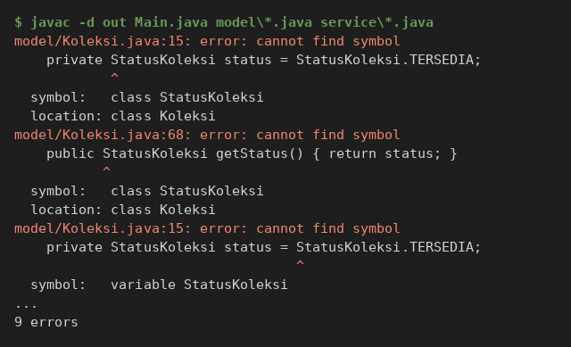

* **After** *(Kondisi akhir / Eksekusi berhasil)*:
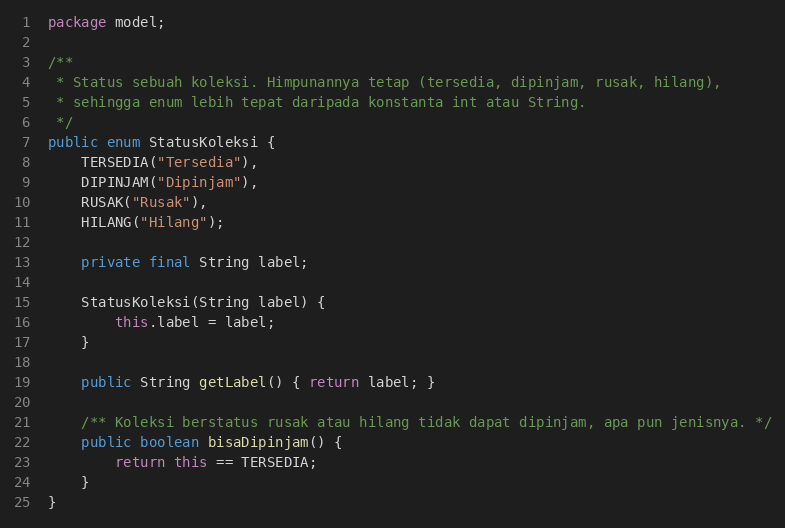

### 1.2. File: `model/Koleksi.java`
**Penjelasan Kode:**
> Kelas abstrak induk semua koleksi. Data yang sama (`nomorInduk`, `judul`, `penulis`, `tahun`, `jumlahEksemplar`, `status`) ditulis sekali di sini. Constructor menolak nomor induk atau judul kosong, tahun yang tidak positif, dan jumlah eksemplar negatif. `masaPinjamHari()` dan `bolehDipinjam()` dibuat `abstract` sehingga setiap turunan wajib mengisinya. `tersedia()` bernilai benar bila status mengizinkan dan eksemplar masih ada. `kurangiStok()` menolak stok yang sudah nol dan mengubah status menjadi `DIPINJAM` saat stok habis, sedangkan `tambahStok()` mengembalikannya ke `TERSEDIA`.

**Bukti Eksekusi (Screenshot):**
* **Before** *(Kondisi awal / Kesalahan kompilasi)*:
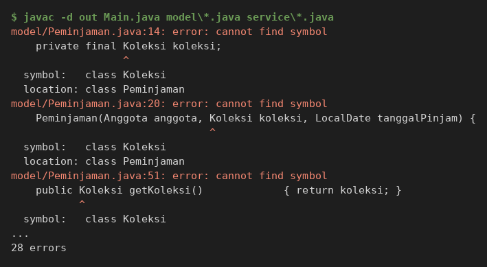

* **After** *(Kondisi akhir / Eksekusi berhasil)*:
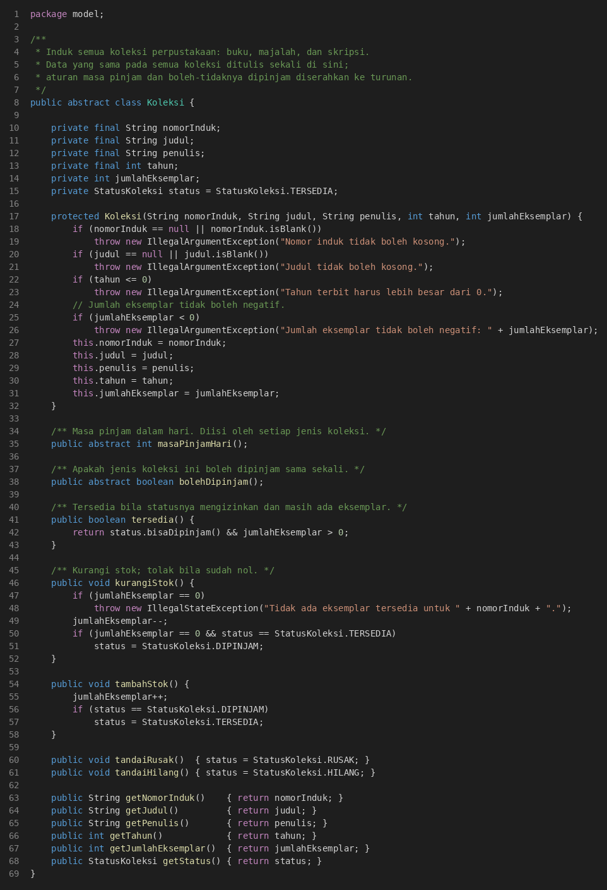

### 1.3. File: `model/Buku.java`
**Penjelasan Kode:**
> Turunan `Koleksi` dengan masa pinjam 14 hari. Inilah **komposisi**: `Bab` dibuat di dalam `Buku` lewat `tambahBab(nomor, judulBab)` yang menerima nomor dan judul, bukan objek `Bab`. Method ini menolak nomor tidak positif, judul kosong, dan nomor yang sudah ada. `getBab()` mengembalikan `List.copyOf(bab)` sehingga daftar asli tidak bisa diubah dari luar. `Bab` adalah kelas bersarang berkonstruktor privat, sehingga hanya `Buku` yang dapat membuatnya. Penolakan jumlah eksemplar negatif dilakukan di constructor `Koleksi` yang dipanggil lewat `super(...)`.

**Bukti Eksekusi (Screenshot):**
* **Before** *(Kondisi awal / Kesalahan kompilasi)*:
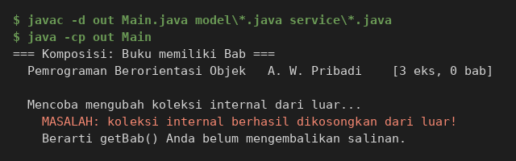

* **After** *(Kondisi akhir / Eksekusi berhasil)*:
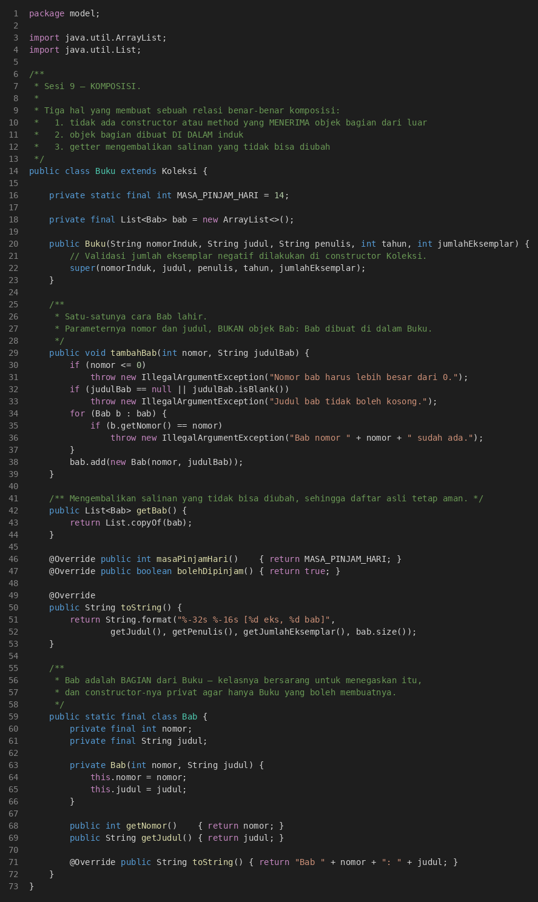

### 1.4. File: `model/Majalah.java`
**Penjelasan Kode:**
> Turunan `Koleksi` yang hanya dapat dipinjam selama 3 hari (`masaPinjamHari()` = 3, `bolehDipinjam()` = `true`).

**Bukti Eksekusi (Screenshot):**
* **Before** *(Kondisi awal / Kesalahan kompilasi)*:
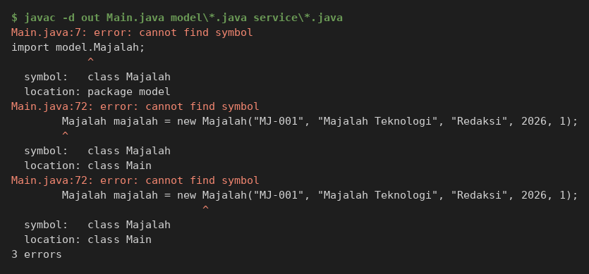

* **After** *(Kondisi akhir / Eksekusi berhasil)*:
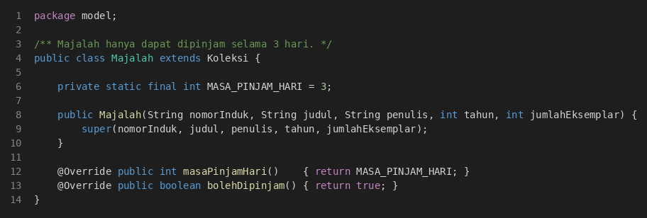

### 1.5. File: `model/Skripsi.java`
**Penjelasan Kode:**
> Turunan `Koleksi` yang sama sekali tidak dapat dipinjam: `bolehDipinjam()` bernilai `false` dan `masaPinjamHari()` bernilai 0. Skripsi hanya boleh dibaca di tempat.

**Bukti Eksekusi (Screenshot):**
* **Before** *(Kondisi awal / Kesalahan kompilasi)*:
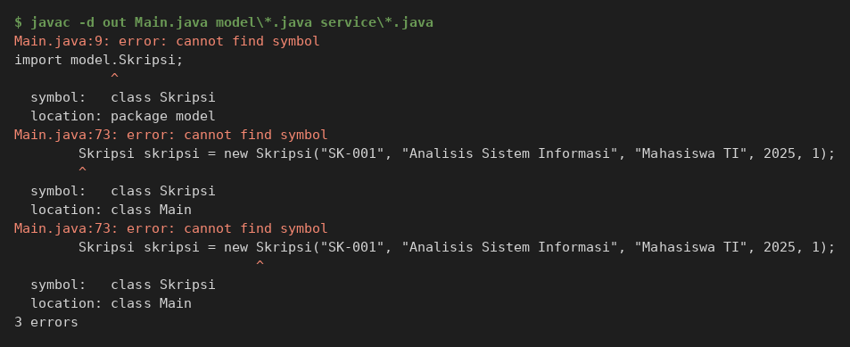

* **After** *(Kondisi akhir / Eksekusi berhasil)*:
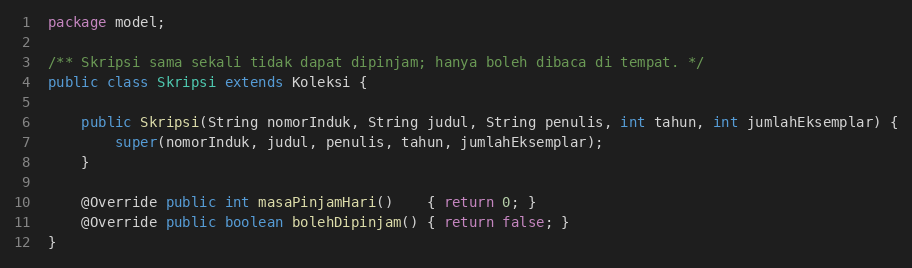

### 1.6. File: `model/JenisKeanggotaan.java`
**Penjelasan Kode:**
> Interface dengan `nama()` dan `dendaPerHari()`. Jenis keanggotaan dibuat interface (bukan enum) karena pihak perpustakaan memperkirakan akan ada jenis baru: jenis baru cukup menambah satu kelas implementasi tanpa menyunting `Anggota`, `Peminjaman`, atau layanan (Open-Closed). Alasan lengkap ada di [analisis.md](analisis.md).

**Bukti Eksekusi (Screenshot):**
* **Before** *(Kondisi awal / Kesalahan kompilasi)*:
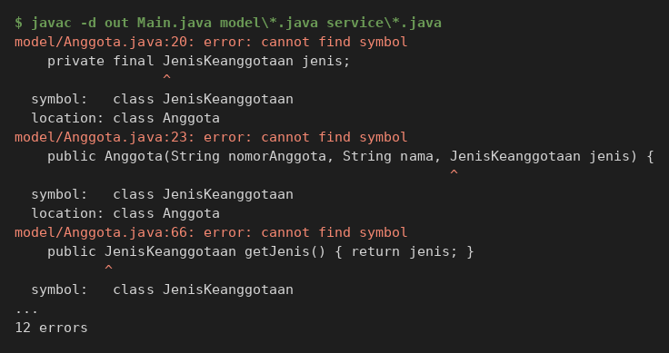

* **After** *(Kondisi akhir / Eksekusi berhasil)*:
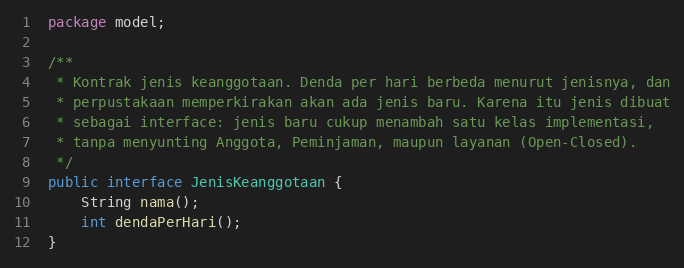

### 1.7. File: `model/KeanggotaanMahasiswa.java, KeanggotaanDosen.java, dan KeanggotaanKehormatan.java`
**Penjelasan Kode:**
> Tiga implementasi `JenisKeanggotaan` yang masing-masing hanya berisi dua method: denda per hari Rp1.000 untuk mahasiswa, Rp500 untuk dosen, dan Rp0 untuk anggota kehormatan.

**Bukti Eksekusi (Screenshot):**
* **Before** *(Kondisi awal / Kesalahan kompilasi)*:
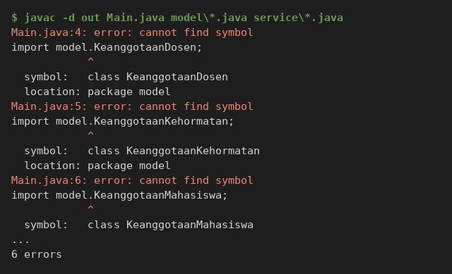

* **After** *(Kondisi akhir / Eksekusi berhasil)*:
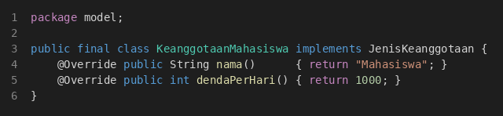
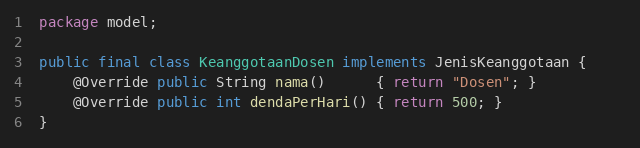
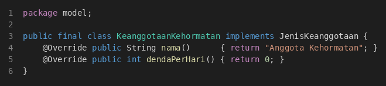

### 1.8. File: `model/Peminjaman.java`
**Penjelasan Kode:**
> Satu catatan peminjaman: anggota, koleksi, tanggal pinjam, tanggal jatuh tempo, dan tanggal kembali. Jatuh tempo dihitung di constructor dari tanggal pinjam ditambah `masaPinjamHari()` koleksi. Constructor sengaja tidak publik, sehingga hanya `Anggota` yang dapat membuatnya. `tanggalKembali` bernilai `null` selama belum dikembalikan. `kembalikan(tanggal)` menolak pengembalian ganda dan tanggal sebelum tanggal pinjam. `hariTerlambat()` dan `hitungDenda()` menghitung denda dari hari terlambat dikali denda per hari jenis keanggotaan.

**Bukti Eksekusi (Screenshot):**
* **Before** *(Kondisi awal / Kesalahan kompilasi)*:
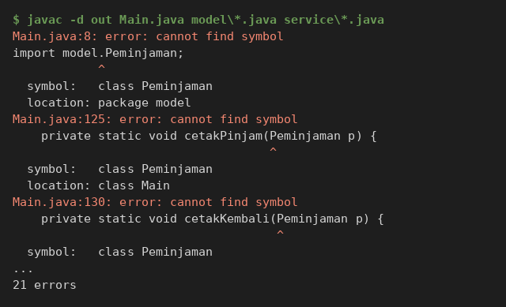

* **After** *(Kondisi akhir / Eksekusi berhasil)*:
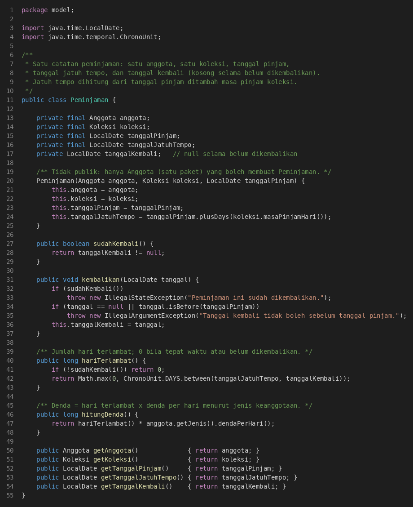

### 1.9. File: `model/Anggota.java`
**Penjelasan Kode:**
> Anggota perpustakaan dengan `nomorAnggota` yang `final` (tidak pernah berubah) dan `JenisKeanggotaan`. `catatPeminjaman(koleksi, tanggal)` adalah satu-satunya cara `Peminjaman` lahir dan menolak peminjaman ke-4 (`BATAS_PINJAMAN` = 3), sehingga relasi `Anggota` dan `Peminjaman` adalah **komposisi**. `getRiwayat()` mengembalikan salinan tak-berubah.

**Bukti Eksekusi (Screenshot):**
* **Before** *(Kondisi awal / Kesalahan kompilasi)*:
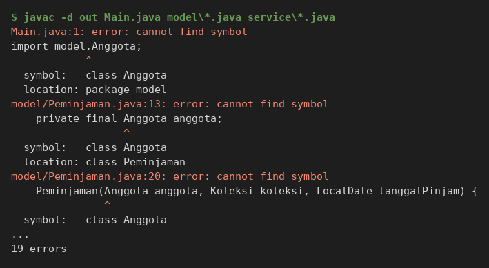

* **After** *(Kondisi akhir / Eksekusi berhasil)*:
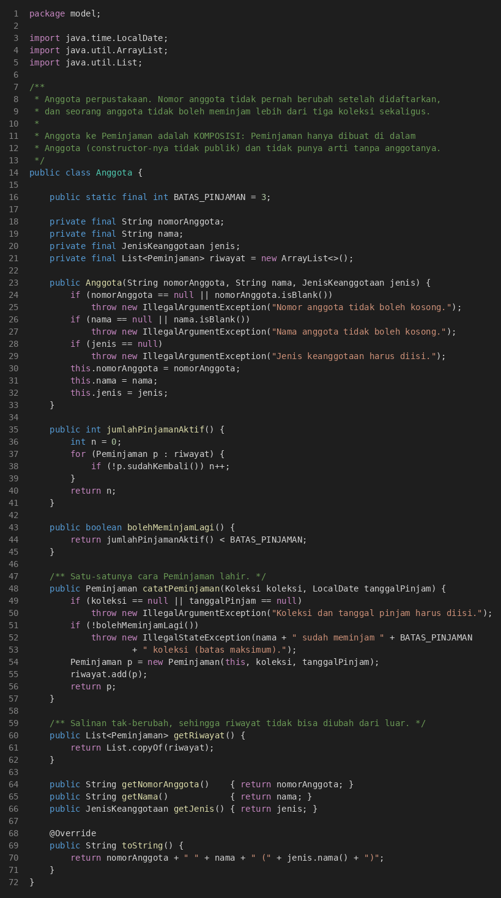

### 1.10. File: `model/Jurusan.java`
**Penjelasan Kode:**
> Pembanding komposisi: **agregasi**. `Jurusan.Mahasiswa` berkonstruktor publik dan dibuat di luar, lalu diterima lewat `daftarkan(m)` (menolak `null` dan NIM yang sudah terdaftar). `keluarkan(m)` hanya melepas dari daftar, sedangkan objek `Mahasiswa` tetap hidup. `getMahasiswa()` mengembalikan salinan tak-berubah.

**Bukti Eksekusi (Screenshot):**
* **Before** *(Kondisi awal / Kesalahan kompilasi)*:
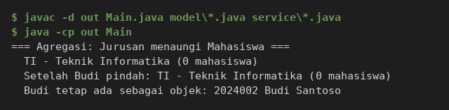

* **After** *(Kondisi akhir / Eksekusi berhasil)*:
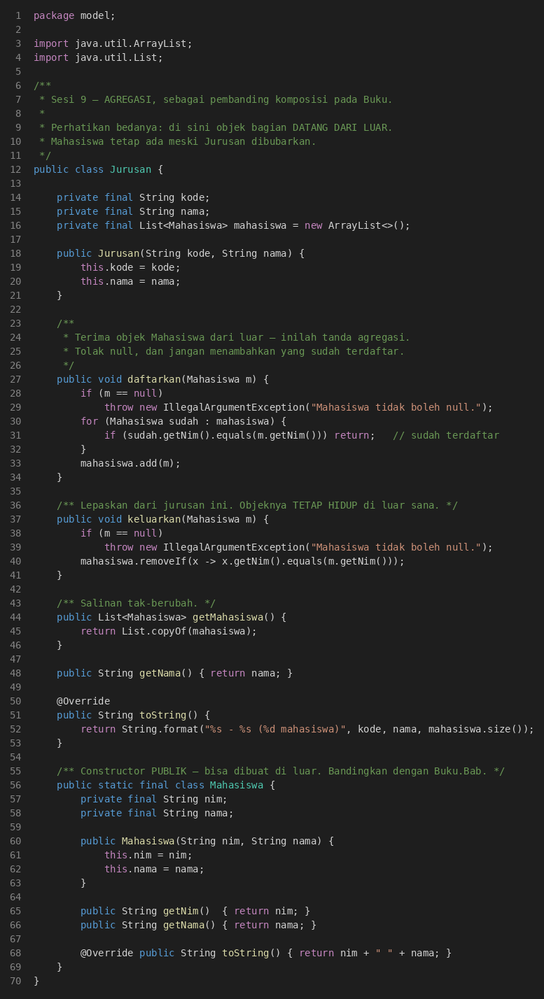

### 1.11. File: `service/PerpustakaanService.java`
**Penjelasan Kode:**
> Lapisan layanan yang **mengagregasi** `Koleksi` dan `Anggota`: keduanya dibuat di luar lalu diterima lewat `tambahKoleksi` dan `daftarkanAnggota` (menolak `null` dan nomor ganda), dan tetap bermakna bila layanan dibubarkan. `pinjam(...)` memeriksa semua aturan sebelum mengubah data apa pun: koleksi boleh dipinjam, masih tersedia, dan anggota belum mencapai batas tiga. `kembalikan(...)` menutup peminjaman, menambah stok, dan mengembalikan objek `Peminjaman` agar denda dapat dibaca. Tersedia juga `daftarSedangDipinjam()` untuk petugas dan `riwayatAnggota(...)` untuk anggota.

**Bukti Eksekusi (Screenshot):**
* **Before** *(Kondisi awal / Kesalahan kompilasi)*:
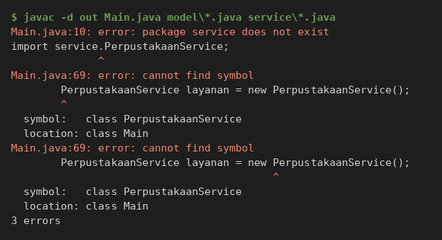

* **After** *(Kondisi akhir / Eksekusi berhasil)*:
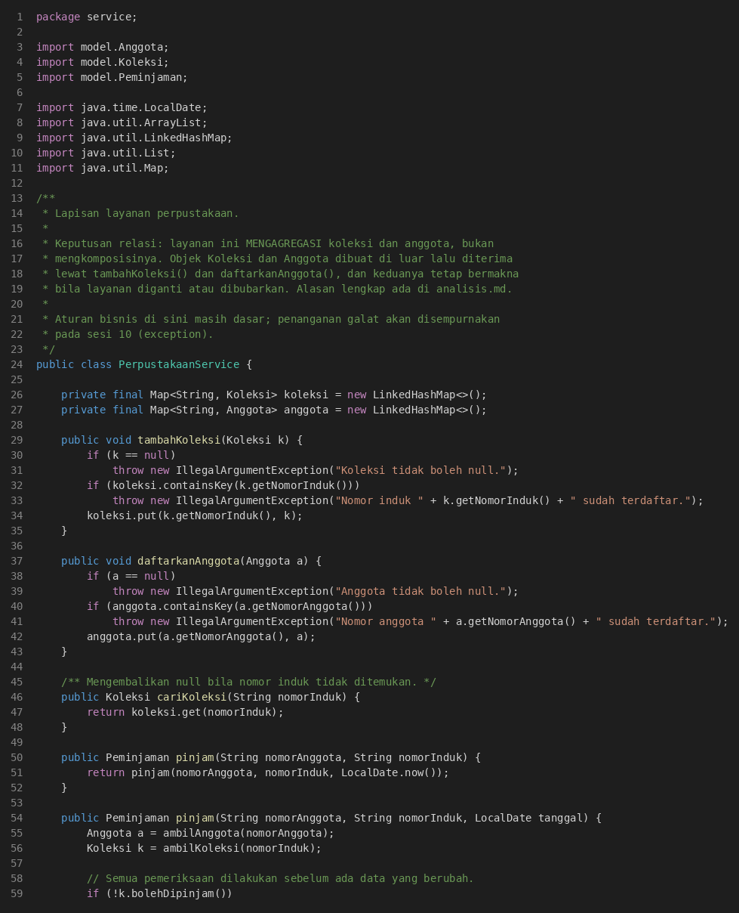
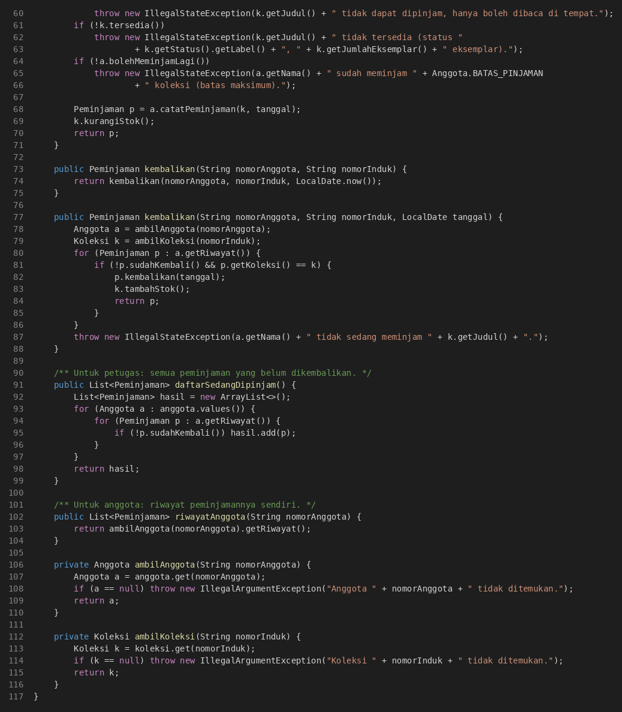

### 1.12. File: `Main.java`
**Penjelasan Kode:**
> Bagian komposisi dan agregasi dari starter dipertahankan (dengan tahun terbit ditambahkan pada constructor `Buku`), termasuk percobaan `getBab().clear()` yang harus ditolak. Ditambahkan bagian layanan: tiga jenis koleksi dan tiga jenis anggota dibuat di luar lalu didaftarkan, peminjaman menghitung jatuh tempo (buku 14 hari, majalah 3 hari), lima aturan ditunjukkan ditolak (skripsi, eksemplar habis, batas tiga pinjaman, koleksi rusak, koleksi tidak dikenal), dan pengembalian terlambat 5 hari menghasilkan denda Rp5.000 (mahasiswa), Rp2.500 (dosen), dan Rp0 (kehormatan).

**Bukti Eksekusi (Screenshot):**
* **Before** *(Kondisi awal / Kesalahan kompilasi)*:
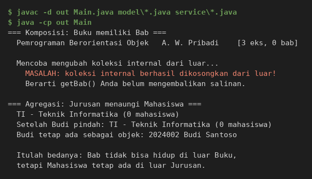

* **After** *(Kondisi akhir / Eksekusi berhasil)*:
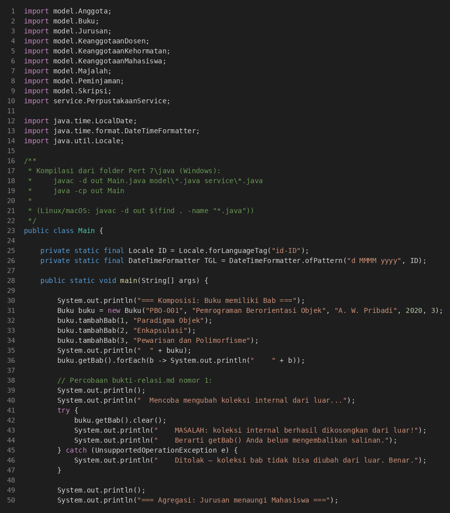
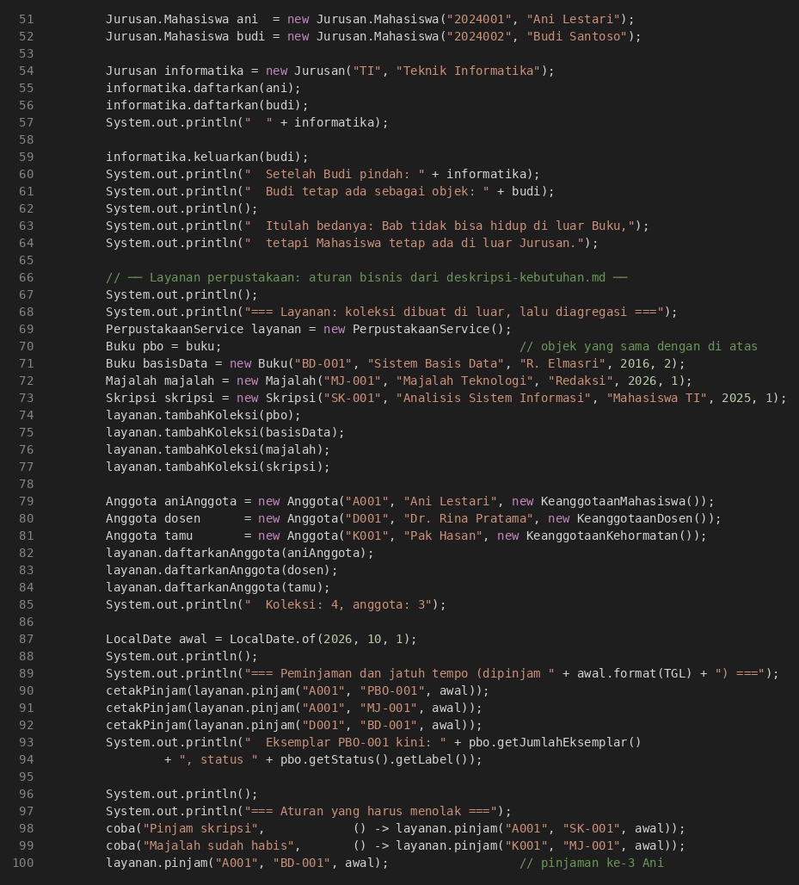
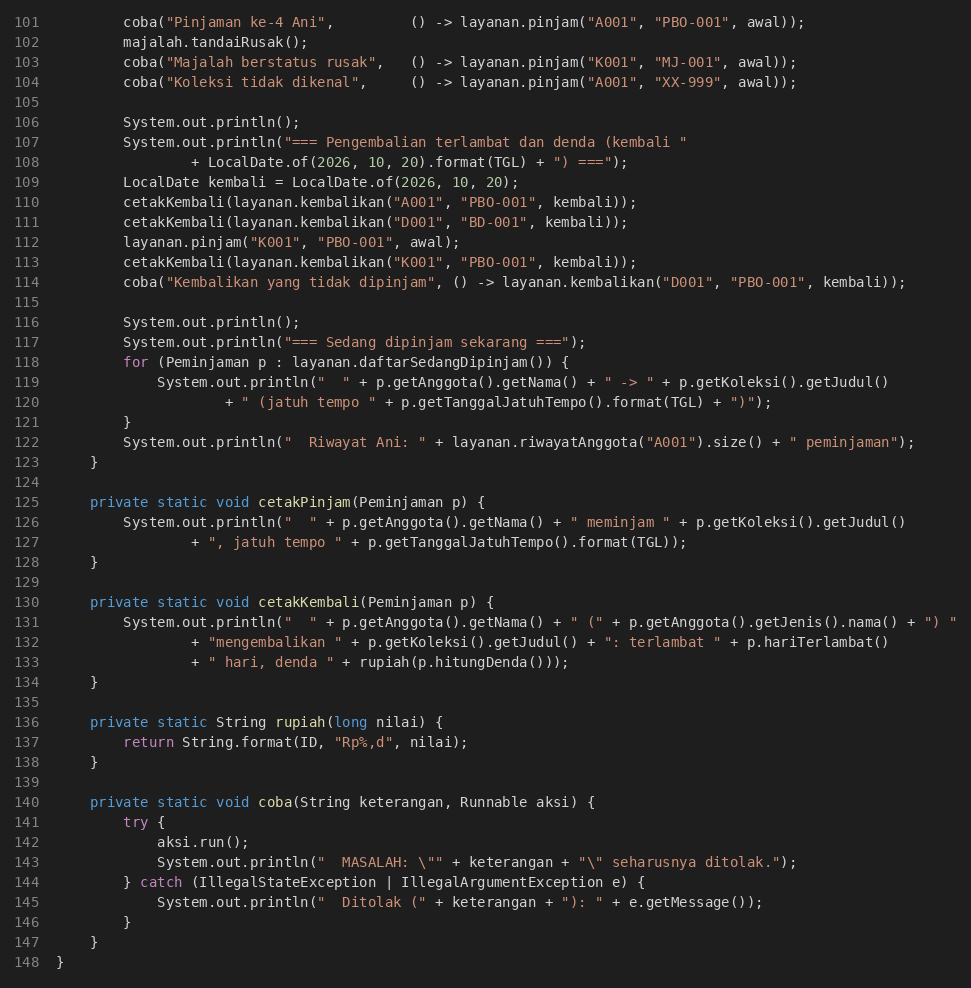

### 1.13. File: `uml/perpustakaan.puml` (Class Diagram)
**Penjelasan Kode:**
> Class diagram mencakup seluruh kelas di kode Java (dan sebaliknya), sesuai syarat kerangka. Pewarisan memakai garis penuh berkepala segitiga kosong, realisasi interface memakai garis putus, komposisi memakai belah ketupat penuh, agregasi memakai belah ketupat kosong, dan asosiasi memakai panah terbuka, lengkap dengan multiplicity di kedua ujung. Kesalahan pada kerangka (`Koleksi <|-- Bab`) diperbaiki menjadi komposisi `Buku *-- Bab`. Gambar di bawah dirender dari definisi yang sama dengan berkas `.puml` memakai Graphviz. Alasan tiap relasi ada di [analisis.md](analisis.md).

**Bukti Eksekusi (Screenshot):**
* **Before** *(Kondisi awal / Kesalahan kompilasi)*:
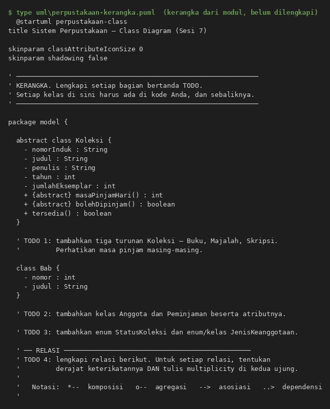

* **After** *(Kondisi akhir / Eksekusi berhasil)*:
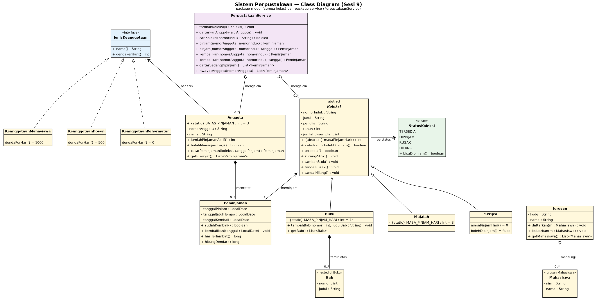

### Output
**Output Program:**
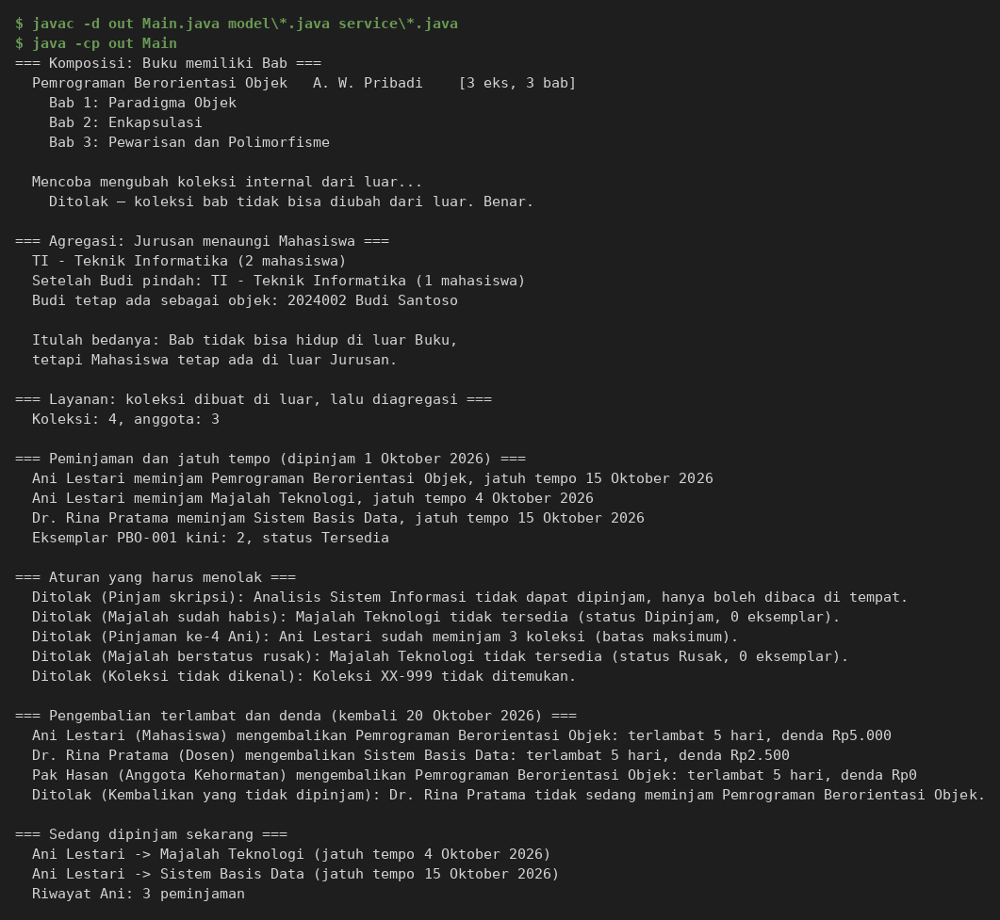

---

## 2. Implementasi PHP

### 2.1. File: `relasi.php`
**Penjelasan Kode:**
> Seluruh bagian relasi dalam satu berkas. `Bab` memakai constructor promotion `private readonly` (nomor dan judul). Karena PHP tidak punya kelas bersarang, aturan "hanya dibuat dari dalam `Buku`" dijaga lewat konvensi `@internal`, dan catatannya ada di [bukti-relasi.md](bukti-relasi.md). `Buku` menolak jumlah eksemplar negatif dengan `InvalidArgumentException`, dan `tambahBab(nomor, judul)` adalah satu-satunya cara `Bab` lahir (menolak nomor tidak positif, judul kosong, dan nomor ganda). `kurangiStok()` menolak stok yang sudah nol dengan `LogicException`. `getBab()` mengembalikan larik by-value, dan `Bab` dibuat `readonly` karena objek di dalam larik tetap berbagi referensi. `Jurusan::daftarkan` menerima `Mahasiswa` dari luar tanpa duplikat NIM (agregasi), dan `keluarkan` hanya melepasnya.

**Bukti Eksekusi (Screenshot):**
* **Before** *(Kondisi awal / Galat logika)*:
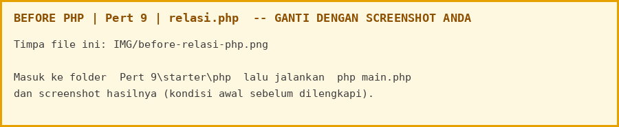

* **After** *(Kondisi akhir / Eksekusi berhasil)*:
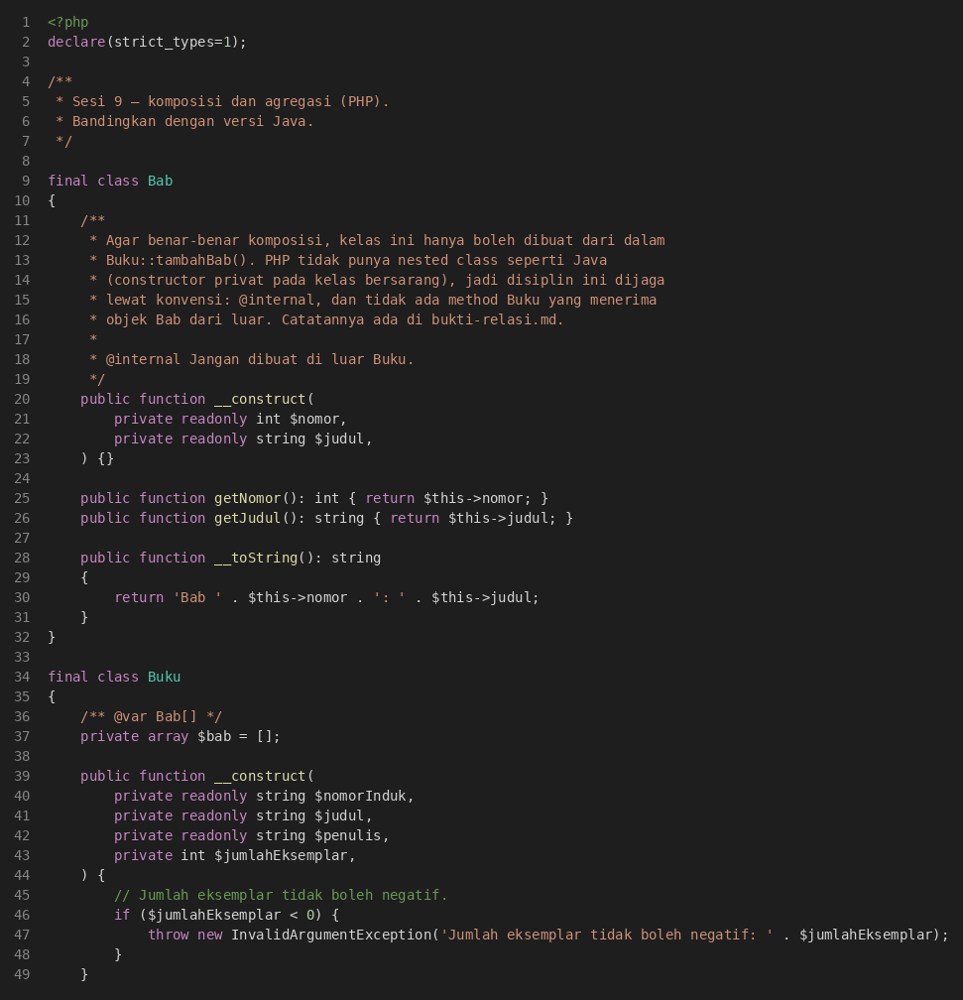
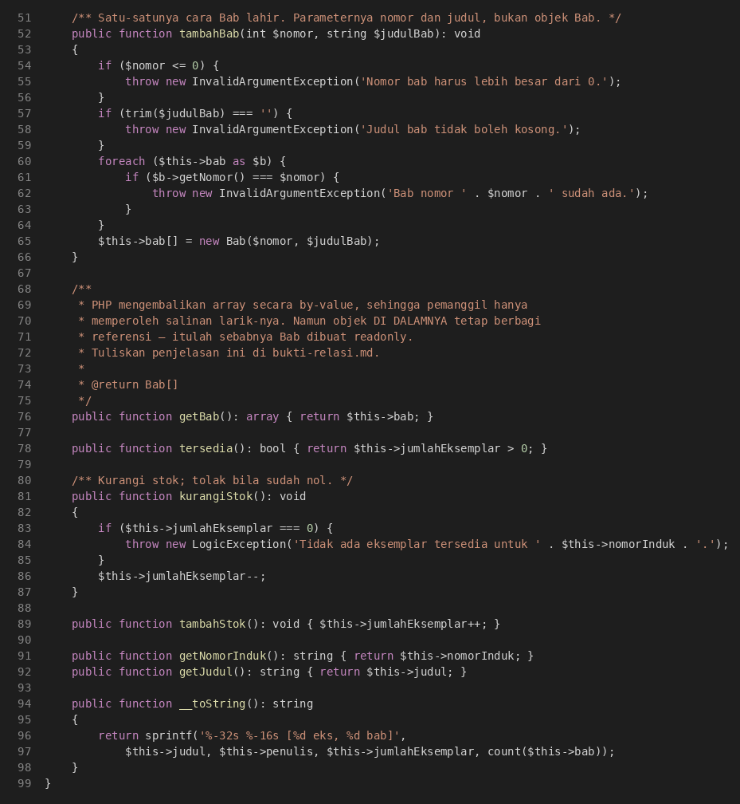
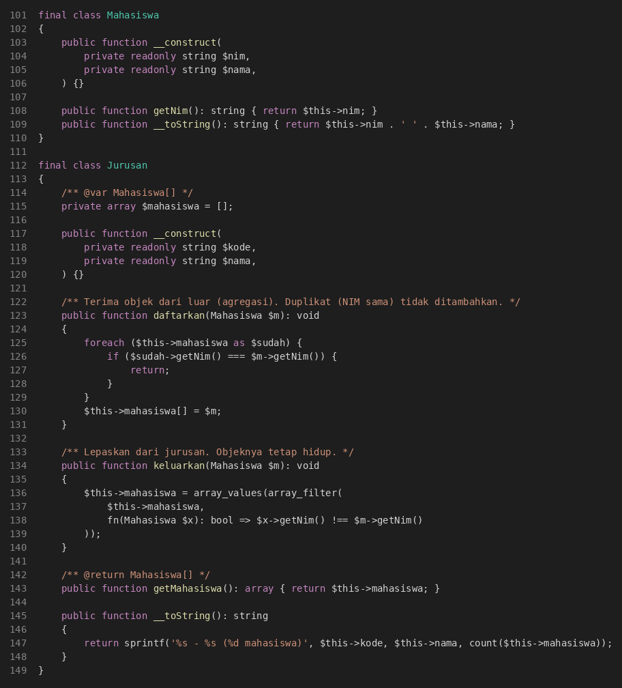

### 2.2. File: `main.php`
**Penjelasan Kode:**
> Memuat `relasi.php` dengan `require_once` lalu menjalankan skenario yang sama dengan `Main.java` pada bagian komposisi dan agregasi. Sebagai padanan percobaan `getBab().clear()`, program mengosongkan salinan larik dari `getBab()` dan membuktikan bab di dalam `Buku` tetap 3.

**Bukti Eksekusi (Screenshot):**
* **Before** *(Kondisi awal / Galat logika)*:
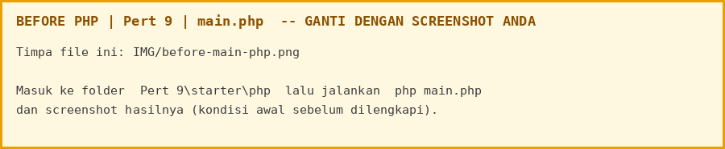

* **After** *(Kondisi akhir / Eksekusi berhasil)*:
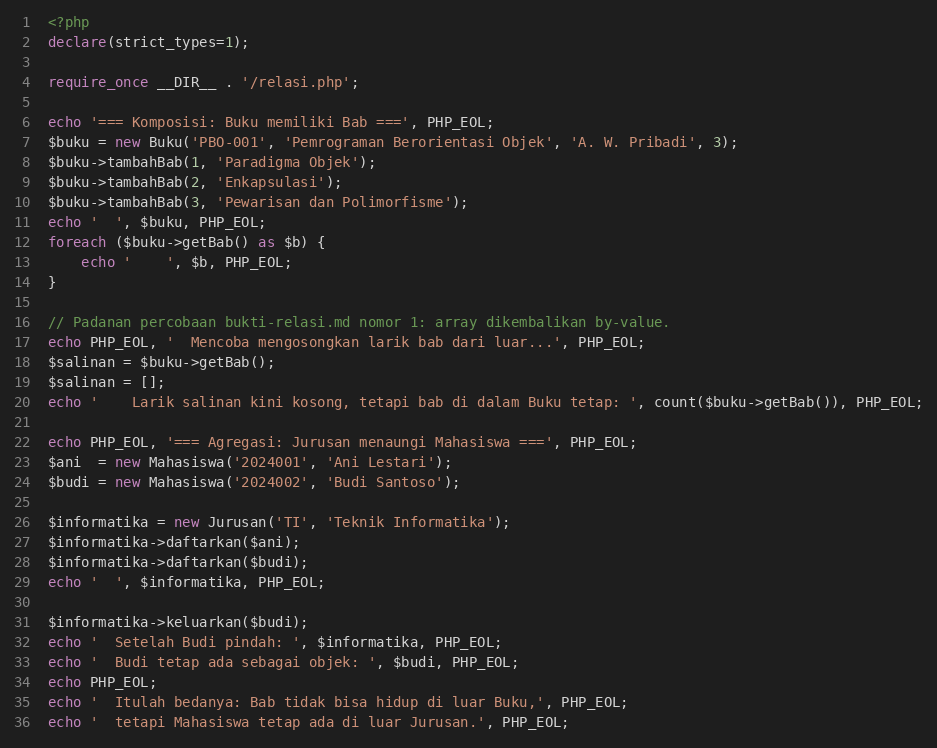

### Output
**Output Program:**
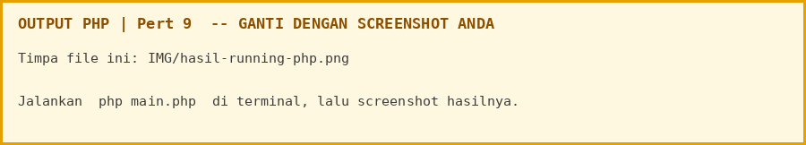

**Keluaran yang diharapkan:**

`php main.php`
```text
=== Komposisi: Buku memiliki Bab ===
  Pemrograman Berorientasi Objek   A. W. Pribadi    [3 eks, 3 bab]
    Bab 1: Paradigma Objek
    Bab 2: Enkapsulasi
    Bab 3: Pewarisan dan Polimorfisme

  Mencoba mengosongkan larik bab dari luar...
    Larik salinan kini kosong, tetapi bab di dalam Buku tetap: 3

=== Agregasi: Jurusan menaungi Mahasiswa ===
  TI - Teknik Informatika (2 mahasiswa)
  Setelah Budi pindah: TI - Teknik Informatika (1 mahasiswa)
  Budi tetap ada sebagai objek: 2024002 Budi Santoso

  Itulah bedanya: Bab tidak bisa hidup di luar Buku,
  tetapi Mahasiswa tetap ada di luar Jurusan.
```

---

## 3. Kesimpulan

> Relasi antar kelas ditentukan oleh pertanyaan sederhana: *bisakah bagian hidup tanpa keseluruhannya?* Bila tidak, relasinya komposisi dan bagian hanya boleh lahir di dalam induknya. Bila ya, relasinya agregasi atau asosiasi.
>
> | Relasi | Jenis | Alasan singkat |
> |---|---|---|
> | `Buku` dan `Bab` | Komposisi (1 ke 0..*) | Bab tidak bermakna di luar bukunya |
> | `Anggota` dan `Peminjaman` | Komposisi (1 ke 0..*) | Peminjaman dibuat di dalam anggota |
> | `Peminjaman` dan `Koleksi` | Asosiasi (* ke 1) | Koleksi tetap ada tanpa peminjaman |
> | `Jurusan` dan `Mahasiswa` | Agregasi (1 ke 0..*) | Mahasiswa dibuat di luar dan tetap hidup |
> | `PerpustakaanService` dan `Koleksi`, `Anggota` | Agregasi (1 ke 0..*) | Keduanya dibuat di luar lalu diterima layanan |
>
> Tiga syarat komposisi yang dibuktikan di [bukti-relasi.md](bukti-relasi.md): tidak ada method yang menerima objek bagian dari luar, bagian dibuat di dalam induk, dan getter mengembalikan salinan tak-berubah. Percobaan menunjukkan `getBab()` yang mengembalikan daftar asli bisa dikosongkan dari luar, sedangkan `List.copyOf` menolaknya, dan kompilator menolak pembuatan `Buku.Bab` maupun `Peminjaman` dari luar. Jenis keanggotaan dibuat interface karena akan ada jenis baru (Open-Closed), sedangkan status koleksi tetap enum.
>
> Hasil pengujian di `Main.java` (dihitung manual): dipinjam 1 Oktober 2026, buku jatuh tempo 15 Oktober dan majalah 4 Oktober; dikembalikan 20 Oktober, buku terlambat 5 hari sehingga denda mahasiswa 5 x 1.000 = Rp5.000, dosen 5 x 500 = Rp2.500, dan anggota kehormatan Rp0.
>
> PHP hanya mengerjakan bagian relasi yang ada di starter (`Buku`, `Bab`, `Jurusan`, `Mahasiswa`), sedangkan class diagram dan model lengkap ada di Java.
>
> Dokumen pendukung: [analisis.md](analisis.md) (analisis kata benda, kata kerja, aturan, dan keputusan relasi), [bukti-relasi.md](bukti-relasi.md) (percobaan komposisi dan agregasi), [deskripsi-kebutuhan.md](deskripsi-kebutuhan.md), [uml/perpustakaan.puml](uml/perpustakaan.puml), dan folder [starter/](starter/) (berkas asli dari modul, tidak diubah).
>
> Cara menjalankan:
> ```cmd
> cd "Pert 9\java"
> javac -d out Main.java model\*.java service\*.java
> java -cp out Main
>
> cd ..\php
> php main.php
> ```
