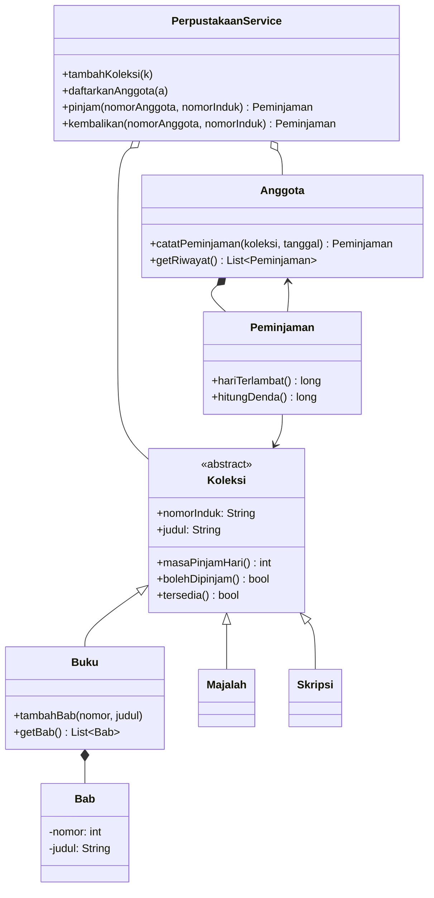

<div align="center">

# 🧩 Praktikum Pemrograman Berorientasi Objek

**Dari objek pertama sampai komposisi dan agregasi, ditulis dalam dua bahasa: Java ☕ dan PHP 🐘**


| | |
|---|---|
| 👤 **Nama** | Muhammad Salman Al Farisi |
| 🪪 **NPM** | 4525210141 |
| 📚 **Mata Kuliah** | Pemrograman Berorientasi Objek (Kelas A) |
| 🏫 **Kampus** | Universitas Pancasila, Fakultas Teknik, Informatika |

</div>

---

## 🗺️ Peta Perjalanan

Setiap pertemuan membangun di atas pertemuan sebelumnya. Mulai dari menjaga data tetap benar, sampai memodelkan relasi antarobjek dengan komposisi dan agregasi.

```mermaid
flowchart LR
    Z["🌱 P1<br/>Objek Pertama"] --> A["🔒 P2<br/>Enkapsulasi"] --> B["🏗️ P3<br/>Constructor & Static"]
    B --> C["🧬 P4<br/>Pewarisan"]
    C --> D["🎭 P5<br/>Polimorfisme"]
    D --> E["🧩 P6<br/>Abstraksi"]
    E --> F["📐 P7<br/>UML & Relasi"]
    F --> G["🔗 P8/P9<br/>Komposisi & Agregasi"]
    style Z fill:#fffde7,stroke:#F9A825,color:#000
    style A fill:#e8f5e9,stroke:#2ea44f,color:#000
    style B fill:#e3f2fd,stroke:#0A66C2,color:#000
    style C fill:#fff3e0,stroke:#ED8B00,color:#000
    style D fill:#f3e5f5,stroke:#8E24AA,color:#000
    style E fill:#e0f7fa,stroke:#00838F,color:#000
    style F fill:#fce4ec,stroke:#C62828,color:#000
    style G fill:#ede7f6,stroke:#4527A0,color:#000
```



| # | Topik | Studi Kasus | Kata Kunci | Laporan |
|:-:|---|---|---|:-:|
| 1 | 🌱 **Lingkungan pengembangan dan objek pertama** | `HaloObjek` | `private`, `this`, constructor, `.gitignore` | [📄 Buka](Pert%201/README.md) |
| 2 | 🔒 **Enkapsulasi dan invariant** | `Mahasiswa` | validasi constructor, `private final`, method privat pembantu | [📄 Buka](Pert%202/README.md) |
| 3 | 🏗️ **Constructor, static, konstanta** | `RekeningBank` | delegasi `this(...)`, `static`, `final`, named constructor | [📄 Buka](Pert%203/README.md) |
| 4 | 🧬 **Pewarisan, overriding, komposisi** | `Pegawai` | `extends`, `super`, kelas abstrak, "adalah" vs "memiliki" | [📄 Buka](Pert%204/README.md) |
| 5 | 🎭 **Polimorfisme** | `BangunDatar` dan `Notifikasi` | upcasting, dynamic dispatch, Open-Closed, refaktor `instanceof` | [📄 Buka](Pert%205/README.md) |
| 6 | 🧩 **Abstract class, interface, enum, trait** | `Kendaraan`, `Movable`, `Fuelable`, `TipeBahanBakar` | identitas vs kemampuan, `implements` banyak, enum berperilaku, `trait` | [📄 Buka](Pert%206/README.md) |
| 7 | 📐 **Pemodelan relasi objek dan UML Class Diagram** | Sistem Perpustakaan | komposisi, agregasi, asosiasi, dependensi, multiplicity | [📄 Buka](Pert%207/README.md) |
| 8 | 🔗 **UML Class Diagram, Komposisi, dan Agregasi (Java Package)** | Sistem Perpustakaan (`model/`, `service/`) | `package`, komposisi, agregasi, `List.copyOf`, layanan | [📄 Buka](Pert%208/README.md) |
| 9 | 🔗 **UML Class Diagram, Komposisi, dan Agregasi (Java Package)** | Sistem Perpustakaan (`model/`, `service/`) | `package`, komposisi, agregasi, `List.copyOf`, layanan | [📄 Buka](Pert%209/README.md) |

> ℹ️ **Pertemuan 8** tidak ada sesi praktikum (libur/digabung). Folder `Pert 8/` memuat laporan Pertemuan 9 sebagai dokumen pelengkap.

---

## 🔗 Sorotan Terbaru: Pertemuan 9

> **Derajat keterikatan antarobjek harus diputuskan sebelum menulis kode, lalu dibuktikan di kode, bukan hanya di gambar.** Uji sederhana: *"Kalau induknya dihapus, apakah bagian ini masih masuk akal?"*



| Relasi | Jenis | Multiplicity | Alasan singkat |
|---|---|---|---|
| `Buku` — `Bab` | **Komposisi** `*--` | 1 ke 0..* | Bab tidak bermakna di luar bukunya; constructor `Bab` privat |
| `Anggota` — `Peminjaman` | **Komposisi** `*--` | 1 ke 0..* | Peminjaman lahir di dalam `Anggota.catatPeminjaman()` |
| `PerpustakaanService` — `Koleksi`, `Anggota` | **Agregasi** `o--` | 1 ke 0..* | Dibuat di luar, tetap hidup bila layanan dibubarkan |
| `Peminjaman` — `Koleksi`, `Anggota` | **Asosiasi** `-->` | * ke 1 | Hanya menyimpan rujukan |

<details>
<summary><b>✨ Yang dikerjakan di pertemuan 9 (klik untuk membuka)</b></summary>

<br>

| Bagian | Isi |
|---|---|
| ☕ **Java** | `package model`: `StatusKoleksi`, `Koleksi`, `Buku`, `Majalah`, `Skripsi`, `JenisKeanggotaan`, `KeanggotaanMahasiswa`, `KeanggotaanDosen`, `KeanggotaanKehormatan`, `Anggota`, `Peminjaman`, `Jurusan` |
| ☕ **Java** | `package service`: `PerpustakaanService` |
| ☕ **Java** | `Main.java`: demo komposisi, agregasi, peminjaman, penolakan aturan, denda |
| 🐘 **PHP** | `relasi.php` + `main.php`: komposisi `Buku`–`Bab` dan agregasi `Jurusan`–`Mahasiswa` |
| 📐 **UML** | `uml/perpustakaan.puml`: class diagram lengkap dengan multiplicity |
| 📝 **Analisis** | [analisis.md](Pert%209/analisis.md): kata benda, kata kerja, aturan bisnis, keputusan relasi |
| 🔍 **Bukti** | [bukti-relasi.md](Pert%209/bukti-relasi.md): percobaan `getBab().clear()` ditolak, bukti komposisi vs agregasi |

</details>

---

## 🗂️ Struktur Folder

```text
📦 Praktikum-PBO-A-MuhammadSalmanAlFarisi-4525210141
├── 📁 Pert 1/   ☕ java/  🐘 php/  🖼️ IMG/  📝 refleksi.md  📄 README.md
├── 📁 Pert 2/   ☕ java/  🐘 php/  🖼️ IMG/  📝 analisis.md  📄 README.md
├── 📁 Pert 3/   ☕ java/  🐘 php/  🖼️ IMG/  📝 percobaan-static.md  📐 sekuens-constructor.puml  📄 README.md
├── 📁 Pert 4/   ☕ java/  🐘 php/  🖼️ IMG/  📝 justifikasi.md  📝 catatan.md  📐 diagram.puml  📄 README.md
├── 📁 Pert 5/   ☕ java/  🐘 php/  🖼️ IMG/  🧪 percobaan/  🏠 tugas-rumah/  🌱 starter/
│                📝 penelusuran.md  📝 refleksi.md  📝 percobaan-mandiri.md  📝 persiapan-demo.md
│                📐 diagram.puml  📐 sekuens-dispatch.puml  📐 diagram-notifikasi.puml  📄 README.md
├── 📁 Pert 6/   ☕ java/  🐘 php/  📚 latihan/  📐 uml/  🖼️ IMG/  🧪 percobaan/  🌱 starter/
│                📝 keputusan.md  📝 percobaan-mandiri.md  📝 refleksi.md  📝 persiapan-sesi07.md
│                📝 persiapan-demo.md  📄 README.md
├── 📁 Pert 7/   ☕ java/  🐘 php/  📐 uml/  🧪 percobaan/  🏠 tugas-rumah/  🌱 starter/
│                📝 analisis.md  📝 bukti-relasi.md  📝 percobaan-mandiri.md  📝 persiapan-demo.md  📄 README.md
├── 📁 Pert 8/   ☕ java/model/  ☕ java/service/  🐘 php/  📐 uml/  🖼️ IMG/  🌱 starter/
│   (≡ Pert 9)   📝 analisis.md  📝 bukti-relasi.md  📝 deskripsi-kebutuhan.md  📄 README.md
└── 📁 Pert 9/   ☕ java/model/  ☕ java/service/  🐘 php/  📐 uml/  🖼️ IMG/  🌱 starter/
                 📝 analisis.md  📝 bukti-relasi.md  📝 deskripsi-kebutuhan.md  📄 README.md
```

---

## 🚀 Cara Menjalankan

<table>
<tr>
<td width="50%" valign="top">

### ☕ Java
*JDK 17 atau lebih baru*

**Pertemuan 1–6** (tanpa package):
```cmd
cd "Pert 6\java"
javac *.java
java Main
```

**Pertemuan 7** (dengan package, sub-folder):
```cmd
cd "Pert 7\java"
javac -d out Main.java model\*.java service\*.java
java -cp out Main
```

**Pertemuan 8 / 9** (dengan package):
```cmd
cd "Pert 9\java"
javac -d out Main.java model\*.java service\*.java
java -cp out Main
```

</td>
<td width="50%" valign="top">

### 🐘 PHP
*PHP 8.1 atau lebih baru*

**Pertemuan 1–6:**
```cmd
cd "Pert 6\php"
php main.php
php uji-validasi.php
```

**Pertemuan 7:**
```cmd
cd "Pert 7\php"
php main.php
```

**Pertemuan 9:**
```cmd
cd "Pert 9\php"
php main.php
```

Untuk pertemuan lain, ganti angka sesuai nomor pertemuan.

</td>
</tr>
</table>

> 💡 File `.class` tidak ikut di-commit (lihat `.gitignore`).

---

## 🎯 Prinsip yang Dipegang

| Prinsip | Artinya di kode ini |
|---|---|
| 🛡️ **Invariant terjaga** | Objek yang tidak sah ditolak sejak constructor, bukan baru gagal belakangan |
| ♻️ **Tidak menyalin kode** | Perilaku bersama ditulis sekali di induk dan dipakai ulang lewat pewarisan |
| 🔓 **Open-Closed** | Terbuka untuk ditambah, tertutup untuk diubah |
| 🏷️ **Tanpa angka ajaib** | Nilai tetap ditulis sebagai konstanta bernama, dan status ditulis sebagai `enum` |
| 🧩 **Kontrak kecil** | Kemampuan dipecah menjadi interface kecil (`Movable`, `Fuelable`) sehingga tiap kelas hanya menerima yang ia butuhkan |
| 🔗 **Relasi yang tepat** | Komposisi bila bagian tidak bermakna tanpa induknya; agregasi bila bagian tetap hidup setelah dilepas |

---

<div align="center">

**Dibuat dengan ☕ dan banyak `javac`**

*Muhammad Salman Al Farisi · 4525210141 · PBO Kelas A*

</div>
