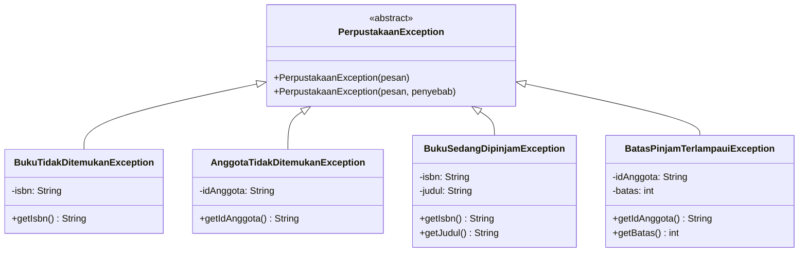

<div align="center">

# 🧩 Praktikum Pemrograman Berorientasi Objek

**Dari objek pertama sampai komposisi dan agregasi, ditulis dalam dua bahasa: Java ☕ dan PHP 🐘**


| | |
|---|---|
| 👤 **Nama** | Muhammad Salman Al Farisi |
| 🪪 **NPM** | 4525210141 |
| 📚 **Mata Kuliah** | Pemrograman Berorientasi Objek (Kelas A) |
| 🏫 **Kampus** | Universitas Pancasila, Fakultas Teknik, Informatika |

</div>

---

## 🗺️ Peta Perjalanan

Setiap pertemuan membangun di atas pertemuan sebelumnya. Mulai dari menjaga data tetap benar, sampai memodelkan relasi antarobjek dengan komposisi dan agregasi.

> **Catatan:** Pertemuan 8 adalah UTS — tidak ada sesi praktikum.

```mermaid
flowchart LR
    Z["🌱 P1<br/>Objek Pertama"] --> A["🔒 P2<br/>Enkapsulasi"] --> B["🏗️ P3<br/>Constructor & Static"]
    B --> C["🧬 P4<br/>Pewarisan"]
    C --> D["🎭 P5<br/>Polimorfisme"]
    D --> E["🧩 P6<br/>Abstraksi"]
    E --> F["📐 P7<br/>UML & Relasi"]
    F --> G["🔗 P9<br/>Komposisi & Agregasi"]
    style Z fill:#fffde7,stroke:#F9A825,color:#000
    style A fill:#e8f5e9,stroke:#2ea44f,color:#000
    style B fill:#e3f2fd,stroke:#0A66C2,color:#000
    style C fill:#fff3e0,stroke:#ED8B00,color:#000
    style D fill:#f3e5f5,stroke:#8E24AA,color:#000
    style E fill:#e0f7fa,stroke:#00838F,color:#000
    style F fill:#fce4ec,stroke:#C62828,color:#000
    style G fill:#ede7f6,stroke:#4527A0,color:#000
    G --> H["🛡️ P10<br/>Exception Handling"]
    style H fill:#fbe9e7,stroke:#BF360C,color:#000
```



| # | Topik | Studi Kasus | Kata Kunci | Laporan |
|:-:|---|---|---|:-:|
| 1 | 🌱 **Lingkungan pengembangan dan objek pertama** | `HaloObjek` | `private`, `this`, constructor, `.gitignore` | [📄 Buka](Pert%201/README.md) |
| 2 | 🔒 **Enkapsulasi dan invariant** | `Mahasiswa` | validasi constructor, `private final`, method privat pembantu | [📄 Buka](Pert%202/README.md) |
| 3 | 🏗️ **Constructor, static, konstanta** | `RekeningBank` | delegasi `this(...)`, `static`, `final`, named constructor | [📄 Buka](Pert%203/README.md) |
| 4 | 🧬 **Pewarisan, overriding, komposisi** | `Pegawai` | `extends`, `super`, kelas abstrak, "adalah" vs "memiliki" | [📄 Buka](Pert%204/README.md) |
| 5 | 🎭 **Polimorfisme** | `BangunDatar` dan `Notifikasi` | upcasting, dynamic dispatch, Open-Closed, refaktor `instanceof` | [📄 Buka](Pert%205/README.md) |
| 6 | 🧩 **Abstract class, interface, enum, trait** | `Kendaraan`, `Movable`, `Fuelable`, `TipeBahanBakar` | identitas vs kemampuan, `implements` banyak, enum berperilaku, `trait` | [📄 Buka](Pert%206/README.md) |
| 7 | 📐 **Pemodelan relasi objek dan UML Class Diagram** | Sistem Perpustakaan | komposisi, agregasi, asosiasi, dependensi, multiplicity | [📄 Buka](Pert%207/README.md) |
| ~~8~~ | ~~UTS~~ | — | — | — |
| 9 | 🔗 **UML Class Diagram, Komposisi, dan Agregasi** | Sistem Perpustakaan (`model/`, `service/`) | `package`, komposisi, agregasi, `List.copyOf`, layanan | [📄 Buka](Pert%209/README.md) |
| 10 | 🛡️ **Exception Handling dan Pemrograman Defensif** | Sistem Perpustakaan (`LibraryService`) | hierarki exception, guard clause, try-with-resources, logging | [📄 Buka](Pert%2010/README.md) |

---

## 🔗 Sorotan Terbaru: Pertemuan 10

> **Exception yang baik bukan sekadar teks — ia adalah objek dengan data.** Guard clause mengubah bersarang empat tingkat menjadi baris-baris datar yang langsung menjelaskan mengapa sebuah operasi gagal.



| Teknik | Sebelum (LibraryServiceKotor) | Sesudah (LibraryService) |
|---|---|---|
| Nilai kembali | `boolean` — pemanggil tidak tahu mengapa gagal | `void` — exception membawa alasan |
| Struktur | Bersarang 4 tingkat | Guard clause datar |
| Penutupan resource | Manual / tidak ada | `try-with-resources` (Java), `try-finally` (PHP) |
| Jejak kegagalan | Tidak ada | Dicatat ke file log dengan timestamp |

<details>
<summary><b>✨ Yang dikerjakan di pertemuan 10 (klik untuk membuka)</b></summary>

<br>

| Bagian | Isi |
|---|---|
| ☕ **Java** `exception/` | `PerpustakaanException`, `BukuTidakDitemukanException`, `AnggotaTidakDitemukanException`, `BukuSedangDipinjamException`, `BatasPinjamTerlampauiException` |
| ☕ **Java** | `LibraryServiceKotor.java`: bahan refaktor (bersarang 4 tingkat, return false) |
| ☕ **Java** | `LibraryService.java`: guard clause, exception khusus, try-with-resources, logging |
| ☕ **Java** | `Main.java`: demo otomatis 7 skenario, mode interaktif, ekspor file |
| 🐘 **PHP** | `exceptions.php`: hierarki lengkap dengan constructor property promotion |
| 🐘 **PHP** | `LibraryServiceKotor.php`: bahan refaktor PHP |
| 🐘 **PHP** | `LibraryService.php`: guard clause PHP, try-finally |
| 🐘 **PHP** | `main.php`: demo PHP sejajar dengan Java |
| 📝 **Skenario** | [skenario-uji.md](Pert%2010/skenario-uji.md): 13 skenario lengkap + 3 jawaban pertanyaan |

</details>

---

## 🗂️ Struktur Folder

```text
📦 Praktikum-PBO-A-MuhammadSalmanAlFarisi-4525210141
├── 📁 Pert 1/   ☕ java/  🐘 php/  🖼️ IMG/  📝 refleksi.md  📄 README.md
├── 📁 Pert 2/   ☕ java/  🐘 php/  🖼️ IMG/  📝 analisis.md  📄 README.md
├── 📁 Pert 3/   ☕ java/  🐘 php/  🖼️ IMG/  📝 percobaan-static.md  📐 sekuens-constructor.puml  📄 README.md
├── 📁 Pert 4/   ☕ java/  🐘 php/  🖼️ IMG/  📝 justifikasi.md  📝 catatan.md  📐 diagram.puml  📄 README.md
├── 📁 Pert 5/   ☕ java/  🐘 php/  🖼️ IMG/  🧪 percobaan/  🏠 tugas-rumah/  🌱 starter/
│                📝 penelusuran.md  📝 refleksi.md  📝 percobaan-mandiri.md  📝 persiapan-demo.md
│                📐 diagram.puml  📐 sekuens-dispatch.puml  📐 diagram-notifikasi.puml  📄 README.md
├── 📁 Pert 6/   ☕ java/  🐘 php/  📚 latihan/  📐 uml/  🖼️ IMG/  🧪 percobaan/  🌱 starter/
│                📝 keputusan.md  📝 percobaan-mandiri.md  📝 refleksi.md  📝 persiapan-sesi07.md
│                📝 persiapan-demo.md  📄 README.md
├── 📁 Pert 7/   ☕ java/model/  ☕ java/service/  🐘 php/src/  📐 uml/  🧪 percobaan/  🏠 tugas-rumah/  🌱 starter/
│                📝 analisis.md  📝 bukti-relasi.md  📝 percobaan-mandiri.md  📝 persiapan-demo.md  📄 README.md
│   (Pert 8 = UTS, tidak ada praktikum)
└── 📁 Pert 9/   ☕ java/model/  ☕ java/service/  🐘 php/  📐 uml/  🖼️ IMG/  🌱 starter/
                 📝 analisis.md  📝 bukti-relasi.md  📝 deskripsi-kebutuhan.md  📄 README.md
└── 📁 Pert 10/  ☕ java/exception/  ☕ java/  🐘 php/  🌱 starter/
                 📝 skenario-uji.md  📄 README.md
```

---

## 🚀 Cara Menjalankan

<table>
<tr>
<td width="50%" valign="top">

### ☕ Java
*JDK 17 atau lebih baru*

**Pertemuan 1–6** (tanpa package):
```cmd
cd "Pert 6\java"
javac *.java
java Main
```

**Pertemuan 7** (dengan package):
```cmd
cd "Pert 7\java"
javac -d out Main.java model\*.java service\*.java
java -cp out Main
```

**Pertemuan 9** (dengan package):
```cmd
cd "Pert 9\java"
javac -d out Main.java model\*.java service\*.java
java -cp out Main
```

**Pertemuan 10** (dengan package exception):
```cmd
cd "Pert 10\java"
javac -d out exception\*.java LibraryServiceKotor.java LibraryService.java Main.java
java -cp out Main
```

</td>
<td width="50%" valign="top">

### 🐘 PHP
*PHP 8.1 atau lebih baru*

**Pertemuan 1–6:**
```cmd
cd "Pert 6\php"
php main.php
php uji-validasi.php
```

**Pertemuan 7:**
```cmd
cd "Pert 7\php"
php main.php
```

**Pertemuan 9:**
```cmd
cd "Pert 9\php"
php main.php
```

**Pertemuan 10:**
```cmd
cd "Pert 10\php"
php main.php
```

Untuk pertemuan lain, ganti angka sesuai nomor pertemuan.

</td>
</tr>
</table>

> 💡 File `.class` tidak ikut di-commit (lihat `.gitignore`).

---

## 🎯 Prinsip yang Dipegang

| Prinsip | Artinya di kode ini |
|---|---|
| 🛡️ **Invariant terjaga** | Objek yang tidak sah ditolak sejak constructor, bukan baru gagal belakangan |
| ♻️ **Tidak menyalin kode** | Perilaku bersama ditulis sekali di induk dan dipakai ulang lewat pewarisan |
| 🔓 **Open-Closed** | Terbuka untuk ditambah, tertutup untuk diubah |
| 🏷️ **Tanpa angka ajaib** | Nilai tetap ditulis sebagai konstanta bernama, dan status ditulis sebagai `enum` |
| 🧩 **Kontrak kecil** | Kemampuan dipecah menjadi interface kecil (`Movable`, `Fuelable`) sehingga tiap kelas hanya menerima yang ia butuhkan |
| 🔗 **Relasi yang tepat** | Komposisi bila bagian tidak bermakna tanpa induknya; agregasi bila bagian tetap hidup setelah dilepas |

---

<div align="center">

**Dibuat dengan ☕ dan banyak `javac`**

*Muhammad Salman Al Farisi · 4525210141 · PBO Kelas A*

</div>
